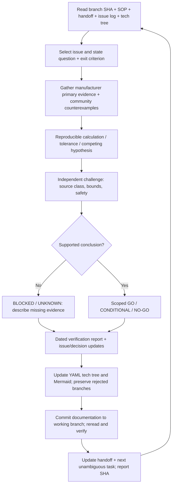

# AI verification and design operating procedure

Version: 1.1 — updated 2026-11-18 JST; original created 2026-11-17 JST
Scope: Research, analysis, design decisions and documentation for PROJECT-NIXIDORO. **Not** authorization for hardware manufacture, procurement, HV energization or safety approval.

## 0. Why this exists
GitHub is the durable shared state of the project, not a transcript of a single ChatGPT conversation. Every agent must be able to take over from repository files without assuming access to a predecessor's memory. This SOP is prescriptive; existing engineering findings remain in their own versioned reports.

## 1. Required startup (every task, including scheduled tasks)
1. Identify repository `mitsu32m/PROJECT-NIXIDORO`, branch `codex/reva-integrated-prototype-review`; obtain current commit SHA. The connected GitHub fetch tool can read `https://api.github.com/repos/mitsu32m/PROJECT-NIXIDORO/branches`; select the exact branch name and its `commit.sha`. Discover reports through `git/trees/<that-commit-sha>?recursive=1`, then fetch files at that SHA. These paths worked on 2026-11-18; if unavailable in another runtime, report the actual failure and do not substitute a blob SHA. Never use `main` as the working branch.
2. Read `docs/ai-workflow.md` (this file), `docs/verification/handoff.md`, `docs/verification/open-issues.md`, `docs/verification/decisions.md`, `docs/tech-tree.yaml` and `docs/tech-tree.md`.
3. Inspect the latest dated report in `docs/verification/`, relevant baseline schematic/docs and any relevant scripts. Do not accept a static snapshot as current if GitHub has newer changes.
4. Check branch changes since the last examined SHA to avoid lost or overlapping edits; check for concurrent work before each write.
5. Choose **one bounded work item** (or a related-issue batch for Work integration/Chat C review) with issue IDs, dependencies, exact question and a specific exit criterion. If a task is assigned, keep that scope. Highest priority is not always the largest problem; prefer evidence that unblocks a decision.
6. Record the starting SHA and chosen task in the final report. If the repository is inaccessible, say so and do not pretend state was read.

## 2. Responsibility and permitted operations

| Role | Deliverable | Authorized operations | Requires human approval |
|---|---|---|---|
| Owner / human | Requirements, risk tolerance, budget decisions, design approvals | Decide objectives and accept/reject trade-offs | Always for changing requirements, purchasing, manufacturing or HV work |
| Design lead / ChatGPT | Priority selection, evidence review, Go/Conditional/No-Go in narrow scope, handoff | Read repo, research manufacturers, compute, write documentation to working branch when connected | No unilateral requirements change or hardware safety release |
| Research worker / AI | Source-oriented findings and alternate options | Read sources, cite exact version/page, prepare report | Cannot turn anecdote into manufacturer guarantee |
| Analysis worker / AI | Reproducible math/CSV/sensitivity and counterexample | Compute under explicit boundary conditions; document assumptions | Cannot claim measurements it did not make |
| Implementation / Codex | Small controlled file edits and build/verification logs | On explicitly assigned task: calculations, documents and *draft* KiCad as authorized | No manufacturing output, circuit safety sign-off or merging without approval |
| Independent reviewer / AI or human | Challenge prior assumptions, check equations and evidence | Comment, request revision, reject invalid assertions | Human supervisor reviews HV battery bench tests |

Roles are not separate persistent agents unless a real delegation tool or execution environment actually launches them. A single ChatGPT run may perform multiple roles sequentially; never claim delegation occurred unless it did.

## 3. Workflow — research to next task

Review whether evidence is sufficient **before** accepting a conclusion; an AI's confidence is not a test measurement.

## 4. Mandatory evidence quality
Label each numerical input `GUARANTEED`, `TYPICAL`, `ASSUMED`, `MEASURED` (only if true) or `UNKNOWN`. Include conditions, units, temperature and datasheet version. Distinguish typical efficiency charts from guaranteed current limits, community build examples from qualified product specifications, static tolerance from switching transients, ERC success from hardware proof. Preserve failed approaches and why they failed.

Each review must consider relevant adversarial questions: lowest supply voltage, maximum demand, startup/inrush, open load, fault and abrupt shutdown, tolerance corners, thermal bottlenecks, PCB layout sensitivity, and subsystem interactions. It need not solve *every* question in a single run; identify those outside current scope.

## 5. Bounded task contract and output
Every task begins with a short contract:
- **Task ID / parent issue / branch SHA / owner or AI role**
- **Question** and *scope exclusions*
- **Inputs and exact repository references**
- **Testable exit criteria**, source priorities, numerical worst cases required
- **Output file paths**, expected schema, what is forbidden
- **Blockers** and when to stop instead of speculating

Every task ends with:
- A dated file in `docs/verification/YYYY-MM-DD-HHMM-JST-topic.md` based on [template](verification/TEMPLATE.md).
- Explicit result: `GO`, `CONDITIONAL`, `NO-GO` or `BLOCKED` (scoped); exact evidence and limitations.
- State sync: `docs/verification/open-issues.md`, `docs/verification/decisions.md` when affected; `docs/tech-tree.yaml` and `docs/tech-tree.md` updated together when new evidence affects nodes.
- `docs/verification/handoff.md` refresh for changed priorities or major conclusions.
- Commit SHA, exact paths and comparison against previous conclusion. If not saved to GitHub, say **NOT COMMITTED**.

## 6. Single source of truth per concern

| Concern | Canonical location |
|---|---|
| Operation/protocol | `docs/ai-workflow.md` |
| Objective and system architecture | `docs/requirements.md`, `docs/reva-integrated-net-spec.md` |
| Current agent handoff | `docs/verification/handoff.md` |
| Pending questions and close criteria | `docs/verification/open-issues.md` |
| Decisions, rejection and supersession | `docs/verification/decisions.md` |
| Evidentiary history | Dated reports under `docs/verification/` |
| Node state and dependencies | `docs/tech-tree.yaml` |
| Human-readable progress | `docs/tech-tree.md` (Mermaid view) |
| Reproducible numbers | Source scripts and CSV with documented assumptions |
| Electrical implementation | Versioned KiCad drafts; never substitute documentation for actual schematic |

Avoid copying entire source documents; use references to minimize context and maintain a single authoritative version.

## 7. Multi-agent coordination and conflicts
- Before delegating, specify a **unique task ID** and whether the worker may write files. Prefer independent investigations of separate issues, not parallel editing of the same index.
- Workers should submit independent dated report files. A single designated integrator (lead) is responsible for merging conclusions and updating **shared** handoff, issues, decisions and tech-tree files.
- Only one writer at a time may edit a given shared index on the same branch; re-fetch immediately before write with current blob SHA. On conflict, read new state and reconcile rather than overwrite.
- No blind trust in agents, especially in citation interpretation, pinouts, voltage ratings or arithmetic. Another AI reviews consequential results.
- Keep a stable task ID and link evidence reports back to it so different runs can find the latest accepted result.
- If no task scheduler/worker execution capability is connected, this SOP **does not** imply autonomous worker delegation. Use a sequential ChatGPT run instead.

### Non-blocking research fallback (owner-authorized, 2026-11-18)

If Issues/labels/atomic Claim are unavailable, research and scheduled runs continue provisionally from the issue register, tree and latest logs. Do not assert a formal Claim; avoid overlap, write unique PENDING REVIEW reports, and hand reviewed conclusions to Work for shared-index integration. Never stop research or disable schedules solely to complete management infrastructure. Prioritize actual hardware parts, reproducible bounds and prototype decision evidence over repeated hypothetical sensitivity screens.

## 8. Safety gates and scope restrictions
- Hardware design remains `NOT ORDER-READY`: no PCB fabrication release, purchasing, HV energization, main merge or safety signoff by automation.
- HV output ~200–205 V nominal / 16 mA continuous is a **target**, not proof of capability; a reduced maximum current is a proposal until user-approved.
- Never claim MAX668 is universally unsuitable: only the ordinary non-coupled 5 V→205 V single-inductor boost was eliminated by duty-cycle reasoning. Coupled-inductor and flyback variants remain investigation candidates.
- HV5524 recommended HV limit 220 V is *not* a fault voltage target: include full static and transient OVP margins and physical isolation.
- Cell, NTC, charger power-path and sealed enclosure thermal proof are mandatory before operation.
- No simulated test automatically counts as physical verification.

## 9. Review cadence and efficiency
Observed 2026-11-18 JST: dedicated A 0/4/8/12/16/20; B 1/5/9/13/17/21; C 3/9/15/21; a separate weekly Wednesday review also exists. No Work-specific/self-owned task was found. Work aims at at most twice/day only after quota/environment capability and duplication checks; no Work task was created. The scheduler API is the live source of truth; these observations do not guarantee execution or inherited tools. Prefer a narrow novel question in each run; cache conclusions through citations and dated reports instead of rereading all source material. When evidence cannot advance an issue, clearly record the obstacle and select an unrelated useful issue next time.

## 10. Success definition
An entirely new AI with only GitHub access should be able to answer: **(a)** what is known and how, **(b)** what is not proven, **(c)** why each approach was chosen/rejected, **(d)** what task to do next, **(e)** which actions are forbidden, and **(f)** which SHA/files hold the latest evidence. If not, update the ledger before declaring task complete.
