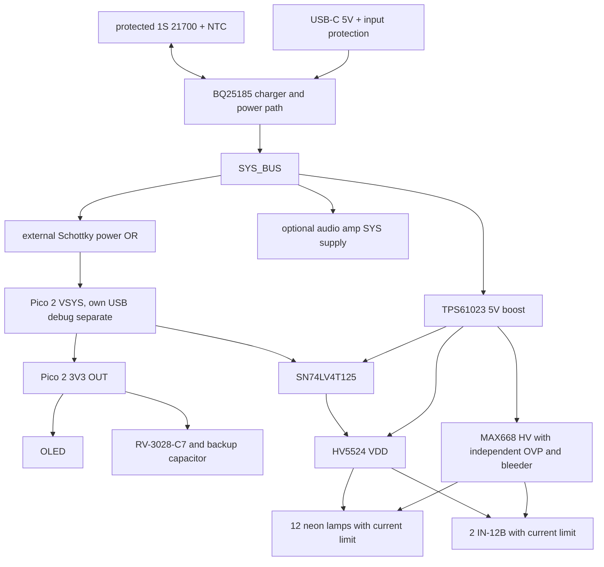

# システム構成 — 提案 v0.1

> このページのIC名や定格は設計候補であり、**確定回路ではない**。最新の基準案は[Rev.A統合ネット仕様](reva-integrated-net-spec.md)。

## 有力な基板分割 [PROPOSED]
- **PWR（電源管理PCB）**: USB-C、BQ25185、電池・NTC、5V TPS61023。独立3.3V TPS63031はRev.A第一候補で省略。試作基板を完成品へ転用する第一候補。
- **HV（高電圧電源PCB）**: MAX668、トランス、OVP、放電、スナバ。試作基板を完成品へ転用する第一候補。
- **CTRL/DISP（制御・表示モジュール）**: RP2350、HV5524、OLED、表示管・操作部接続。筐体制約に応じて制御PCBと表示PCBへ分ける可能性あり。
- **3モジュール=3枚の物理PCBと確定した意味ではない**。コネクタ・電圧・電流・故障時動作の詳細は[モジュール間インターフェース仕様](module-interfaces.md)を参照。

## 2026-11-14 レビューを受けた優先修正 [TO_VERIFY]
- 原資料のIN-12BはDC供給電圧 **200V以上** を示す。**176Vを確定設計値にしない**。200–205Vは暫定評価目標であり、実機の点灯・電流・過渡を測定してから決定する。
- HV5524の連続推奨HVOUTは最大220V、絶対最大230V。200V級運用は余裕が小さい。**独立過電圧監視/停止、残留電荷放電、起動時全消灯を追加**し、過渡最大215V以下という仮目標の成立を試験する。
- **SYS→HV直接経路を廃止してSYS→TPS61023→5V→MAX668へ統一**（5Vレールの入力余裕・負荷・起動順は未検証）。
- **Rev.A第一候補はPico 2**。BQ25185 SYS→外付けダイオード→Pico VSYS、Pico 3V3(OUT)でRTC/OLEDを供給する案。PicoのVBUSにPWR 5Vを接続せず、独立3.3Vレールと並列化しない。XIAO RP2350は省スペース代替候補として履歴に残す。
- BQ25185は熱試験なしに1A充電を確定しない。250/500/750/1000mAを比較、USB-Cの入力電流上限は充電+動作電流の合計へ適用されることに注意。
- 試作を HV電源、表示ドライバ、充電低圧電源、低圧UIに分け、各Go/No-Go試験を通過してから統合する。PCBレイアウトと安全性は教員レビュー前提。
- 詳細: [設計レビュー比較メモ](research/2026-11-14-three-report-review.md)。

## 重要な未検証事項 [TO_VERIFY]
- ネオン球とIN-12Bの**共通HV電圧**。IN-12BのDC供給200V以上を踏まえ、200–205Vを暫定評価するが実測とOVP設計まで未確定。
- ネオン球には**1球につき1本以上の電流制限抵抗**が必要。候補抵抗値は実機試験で確定。
- HV5524 x1は「12 + 2×10 = 32カソード」で収まる案。ただしIN-12Bのコンマ電極を駆動しない前提。
- HV5524の5Vロジック/高耐圧/パッケージと3.3V MCUのレベル変換をデータシート再確認。
- 単セル電池からの昇圧方式、過電圧・過電流保護、シャットダウン/放電の検証。
- 本体ユーザー操作・USB・電池とHV領域の絶縁、故障時安全、発熱。
- 球体と台座を結ぶHV配線と低圧配線は別コネクタ系で検討する。

## 検証順
低電圧LED UI試作 → スモークOLED/筐体の実寸検証 → ネオン球と数字管の個別電気特性検証（監督下） → ドライバ → 電源/電池統合。

## HV5524ブランキング・RTCバックアップ（2026-11-14）
- HV5524真理値表は**BL=LOW、POL=HIGHで全出力OFF**。**BL=LOW、POL=LOWは全出力ON**なので注意。POLを5Vへプルアップ固定、BLをGNDにプルダウンする回路が第一案。HVの独立OVP/放電と置き換えない。
- RTC RV-3028-C7のVBACKUPは低漏れコンデンサ/一次電池を比較。バックアップ切替・トリクルチャージはEEPROM設定が必要。一次電池の充電は禁止。
- 詳細: [表示ドライバ全消灯・RTCバックアップ設計](hv-blanking-rtc-backup.md)。
