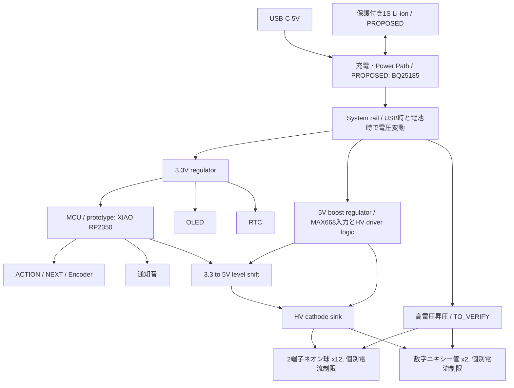

# システム構成 — 提案 v0.1

> このページのIC名や定格は設計候補であり、**確定回路ではない**。

## 有力な基板分割 [PROPOSED]
- 表示基板: 球体前面のネオン球・数字管・電流制限部
- HVドライバ基板: 表示基板背面
- UI/MCU基板: 下部操作台
- 電源基板: USB-C, 充電, 低圧レギュレータ, 昇圧

## 重要な未検証事項 [TO_VERIFY]
- ネオン球とIN-12Bの**共通HV電圧**。特にIN-12B着火余裕。170 Vは仮置きで確定ではない。
- ネオン球には**1球につき1本以上の電流制限抵抗**が必要。候補抵抗値は実機試験で確定。
- HV5524 x1は「12 + 2×10 = 32カソード」で収まる案。ただしIN-12Bのコンマ電極を駆動しない前提。
- HV5524の5Vロジック/高耐圧/パッケージと3.3V MCUのレベル変換をデータシート再確認。
- 単セル電池からの昇圧方式、過電圧・過電流保護、シャットダウン/放電の検証。
- 本体ユーザー操作・USB・電池とHV領域の絶縁、故障時安全、発熱。
- 球体と台座を結ぶHV配線と低圧配線は別コネクタ系で検討する。

## 検証順
低電圧LED UI試作 → スモークOLED/筐体の実寸検証 → ネオン球と数字管の個別電気特性検証（監督下） → ドライバ → 電源/電池統合。
