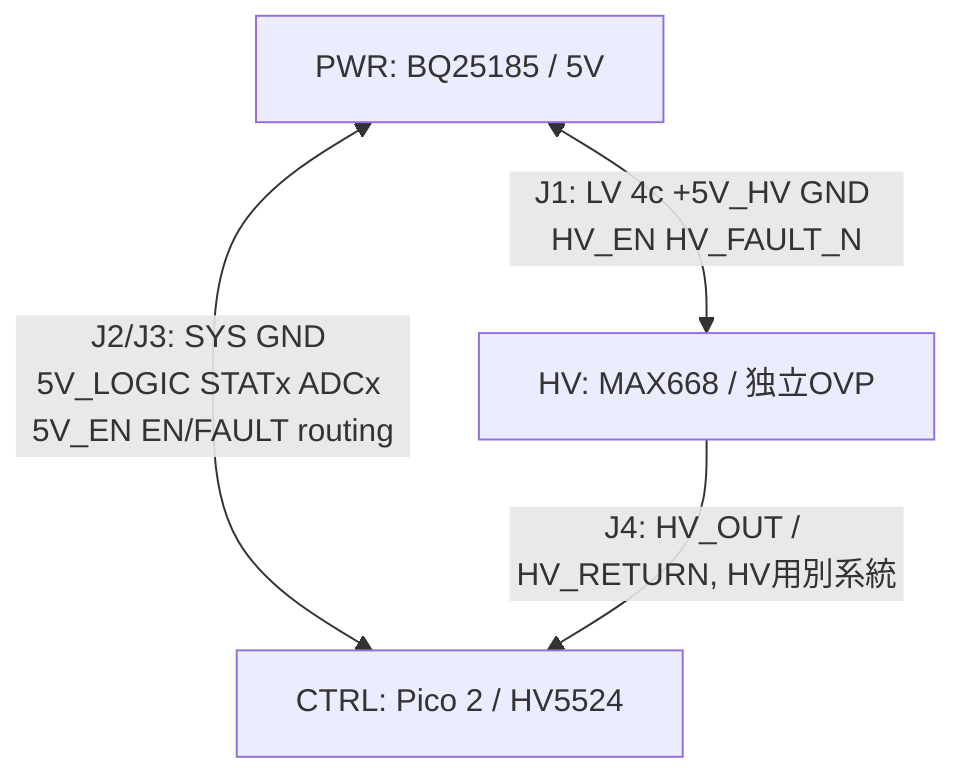

# 基板間コネクタ・ハーネス設計案 — Draft v0.1

> **2026-11-14 Rev.A電源構成の第一候補更新:** RTC・OLEDはPico 2の3V3(OUT)へ統合、アンプはSYS給電＋SHUTDOWNとし、TPS63031とI²C分離ICを削減する案を追加。**実測/発注前検証未了**。詳細：[CTRL電源ドメイン統合案](ctrl-power-domains.md)。以下に残る3V3_PERIPHや分離構成は従来案・比較対象。

Updated: 2026-11-14 JST
Status: PROPOSED / TO_VERIFY。**接続関係と必要ネットを定義したドラフト。実際のピン番号・HV端子部品は未確定。発注用図面ではない。**

## 接続トポロジー

- 3**論理**モジュールのまま。PWR上でHV_ENとHV_FAULT_NをCTRL↔HV間でパススルーする方針。後でレイアウト/ノイズ上の問題があれば、信号専用のCTRL↔HV接続に変更可。
- PWR↔CTRLは負荷電流のある電源系(J2)と小信号/監視系(J3)に**コネクタを分離する方向**。物理的な極数・形状は筐体CADおよび実部品の図面確認後に固定。
- J4は**HV専用接続**。LV XHコネクタを併用しない。200–205V DCを想定し、OVP/過渡を含む定格、十分な絶縁距離、誤挿入・抜去時の露出防止、機械保護、シャットダウン後の電荷放電を満たす方式を別途検証する。
- HV回路が非絶縁ならHV_RETURNは内部的にGND共通となり得るが、帰路設計に従って示し、**独立絶縁電源であると誤認しない**。高電圧の帰路は5Vスイッチング電流の大電流ループに混ぜない。

## J1 PWR ↔ HV：LV 4極（第1候補）
| 論理端子位置案 | ネット | PWR側 | HV側 | フェイルセーフ |
|---:|---|---|---|---|
| 1 | +5V_HV | TPS61023出力（必要なら個別保護/スイッチ） | MAX668 VIN | 過電流/熱で負荷停止 |
| 2 | GND_PWR | LVリターン | LVリターン | 配線・線幅は5V最大電流に合わせる |
| 3 | HV_EN_REQ | CTRL GP4の信号を中継 | 外部ENロジック/起動禁止 | **HV基板内プルダウン等で無接続時OFF** |
| 4 | HV_FAULT_N | CTRL GP5へ中継 | 独立OVPの異常状態（open-drain候補） | HV基板上でOVP停止が成立。MCU通知は追加機能 |
- **Pin1〜4は論理上の順番案**。実際のヘッダ向き/ピン番号はKiCadとメーカー図面で照合。1極ずれ・逆接・異シリーズ誤挿入を設計審査する。
- コネクタ第一候補：**JST XH 4極**（ヘッダ B4B-XH-A 等、ハウジング XHP-4、適合圧着端子は使用電線で確定）。JST XHシリーズ仕様2.5mmピッチ、3A @AWG22、250V AC/DC、-25〜85℃。**これは低圧接続の電流/入手性を比較する候補であり、高圧配線用に採用した意味ではない**。
- 負荷電流の試算はHV 200V×16mA=3.2W, MAX668効率70%仮定→5V約0.914A。5V側に追加消費・起動ピークがあり、**3Aというシリーズ上限をそのままシステム安全保証とはみなさない**。実際のAWG、圧着工具、端子定格、温度、束線、曲げ条件に従う。
- HV_FAULT_Nは3.3VのCTRL入力プルアップを基本案とし、5V直結しない。PWR/CTRL未給電時のGPIOからの逆給電、配線断時の状態（フェイルセーフかどうか）、ノイズ耐性をレビュー。
- ENとFAULTは**安全機能を分担**。HV_ENはソフトウェア許可、独立OVPが硬件停止を優先。ソフトウェアのみのOVPは不可。

## J2 PWR ↔ CTRL：電源専用（Rev.A更新案）
| ネット | 備考 |
|---|---|
| SYS_TO_MCU | BQ25185 SYS→外部ショットキー→Pico VSYSへ。USBのPico内蔵ダイオードORと併用（電圧降下・逆流・USB切替を要検証） |
| GND_LOGIC | 電源の帰路 |
| +5V_LOGIC | HV5524/74AHCT125など5Vロジック用。**Pico 2 VBUSには接続しない** |
| SYS_TO_AMP（任意） | SYS_TO_MCUと同一SYS_BUSをCTRLのアンプ負荷用に分岐する場合のピン。電流・ノイズ次第で一本化可能 |
| GND_SIGNAL/RETURN（追加帰路） | 音声/ロジックのリターンを考慮した追加GNDピン候補 |
- **Pico 2をUSBでデバッグする場合**、Picoの3V3と周辺3V3が異なる電源系になり得る。I²C/SPI/GPIOが電源OFFの周辺ICを経由して逆給電しない回路を設計するまで、「常時USB併用可能」としない。
- Rev.Aは**5ピン候補：SYS_TO_MCU, SYS_TO_AMP(optional), +5V_LOGIC, GND_MAIN, GND_RETURN**。Pico 3V3(OUT)がRTC/OLEDへ給電するためPWR→CTRLに3V3_PERIPHを配線しない。
- 4本のネットが1コネクタに収まるとは限らない。デジタル/アナログGNDのリターン、電流、シーケンスでGNDを複数ピンにする場合あり。

## J3 PWR ↔ CTRL：監視・信号専用（ネット案）
| ネット | 備考 |
|---|---|
| CHG_STAT1 / CHG_STAT2 | BQ25185 status。オープンドレインを3.3V系で受ける案 |
| ADC_BAT / ADC_SYS / ADC_5V | **分圧・保護済みの測定電圧**をCTRL ADC GP26/27/28へ（生電圧を直結しない） |
| PWR_5V_EN | GP16→TPS61023 EN、PWR側LOW既定 |
| ADC_SENSE_EN | GP17→PWR J3 pin10、PWR側R24=100kΩでLOW既定。ADC読取り時だけHIGH |
| PWR_5V_OK | 5V valid通知（比較器/PGの有無は未決定、オプション） |
| HV_EN_REQ | CTRLからPWR経由でJ1へ |
| HV_FAULT_N | J1からPWR経由でCTRLへ |
- **PWR v3のRev.A第一候補は10極（9信号＋GND）**。ADC_SENSE_EN=GP17→PWR J3 pin10を含む。PWR_5V_OKを追加するなら11極又は信号再配置が必要。実コネクタ型番・嵌合・ピン向きは未決定。
- **J2は5ピン候補、J3は10ピン候補**。J3実型番とピン向きはまだ固定しない。
- JST PHは2mmピッチ、2A/100V級の**低電圧小信号**向け比較候補。XH 4極と似た形状の複数コネクタが筐体内にあるため、長さ/極数/異シリーズを選び、誤接続を防止。製造/圧着工具・個別購入価格を確認。

## HW停止の最低要件
1. 無通電、MCUリセット、CTRL抜去、J1端子抜去でHV_EN=OFF。プル抵抗はHV基板側に設置。
2. 独立OVPが異常電圧を検出したら、CTRLからのEN要求に関わらずMAX668の昇圧を停止。
3. HV5524のBL/POL関係と電源投入時の出力OFFを公式表で確認し、5V/3.3Vどちらかがない状態で意図しない点灯をさせない。
4. 重大故障後の自己復帰は許可条件を別途設定。HV停止後のbleeder放電曲線を測定し、ユーザー/作業者が接触できない設計にする。
5. 低圧コネクタの活線挿抜を禁止し、検証時の抜去試験は専用安全治具・教員レビューを前提とする。

## BOM/発注の判断
- XH B4B-XH-AとXHP-4の図面・現在の正規在庫、圧着端子・電線AWG、工具の費用を確認。未調査の価格は記載しない。
- J2/J3は**コストと組立容易性でコネクタの統合/分割を比較**。高電圧と低電圧は統合しない。
- ハーネス製作費/余剰部品、PCB内のコネクタ占有寸法も含める。最初のPWR/HV試作を完成品に転用する目標は維持する。

## 参考・関連
- [module-interfaces.md](module-interfaces.md)
- [pico2-pinmap.md](pico2-pinmap.md)
- [pwr-schematic-plan.md](pwr-schematic-plan.md)
- JST公式XH https://www.jst.com/wp-content/uploads/2025/06/eXH.pdf
- JST公式PH https://www.jst.co.uk/productSeries.php?pid=2944
- Microchip HV5524 https://ww1.microchip.com/downloads/aemDocuments/documents/APID/ProductDocuments/DataSheets/HV5524-32-Channel-Serial-to-Parallel-Converter-Data-Sheet-DS20006850.pdf

**2026-11-14 正本扱いのRev.A統合表:** [reva-integrated-net-spec.md](reva-integrated-net-spec.md)。この文書中の従来の3V3_PERIPH記述・旧極数は比較履歴。
