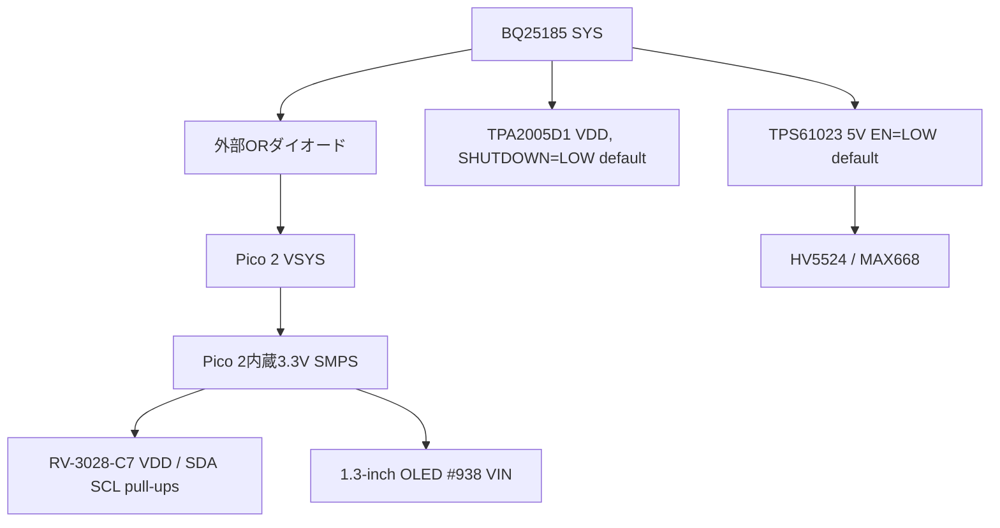

# CTRL電源ドメイン統合案（Rev.A） — 3.3Vレギュレータ削減レビュー
Updated: 2026-11-14 JST
Status: **ARCHITECTURE PROPOSAL / NOT FABRICATION READY**
優先順位: 高電圧/充電のハード安全 ＞ 電源逆流防止 ＞ 起動信頼性 ＞ 予算/製造枚数 ＞ 電池寿命・静音性。

## 1. 第一候補：Pico 2の3V3(OUT)に低電力I2C周辺を統合

- Raspberry Pi Pico 2 **3V3(OUT)は外部回路給電可で、外部負荷300mA未満を推奨**（上限保証ではなくRP2350内部消費・VSYS条件に依存）。Adafruit #938 OLED実使用約25mA（表示による）＋RTC微小電流。最大白画面/起動ピーク/Picoの動作電流・3.3Vリップルを実測し、余裕を確認。
- **OLED/RTCのI2CプルアップはPico 3V3(OUT)の一つのドメインに置く**。Pico GP20/21↔両デバイスSDA/SCL。OLEDブレークアウトに内蔵電源レギュレータ/レベルシフタ/プルアップがあるので、正確なrevの基板回路を確認し、追加プルアップが過大電流とならないようにする。
- **Rev.AはOLED表示OFFコマンドによる消灯を採用。物理電源遮断は採用しない**。OLEDの表示OFFがゼロ消費電流であるとは扱わず、待機電流測定と必要な電池寿命を評価。もしOLED停止中の電流が許容不可なら、OLED専用ロードスイッチと電源OFF時I2C分離を追加するRev.B案へ。
- **RTCはPico 3V3で主動作、VBACKUPは独立の低漏れコンデンサ**（前文書の47µF候補）。Pico電池取り外し後もRTCだけ時刻保持可能な設計。RTC電源切替EEPROM設定・漏れ・実時間の試験が必要。
- **この提案ではTPS63031（独立3.3V Buck-Boost）とTCA39306（I2C分離）がRev.A BOM/PCBから削減候補**。確定削除ではない。3V3_PERIPHがPWR/CTRL間を通らなくなるため、コネクタとPWRネット表は改訂が必要。
- 既存[architecture.md](architecture.md)、[pwr-schematic-plan.md](pwr-schematic-plan.md)、[pwr-schematic-nets.md](pwr-schematic-nets.md)、[ctrl-ui-audio-schematic.md](ctrl-ui-audio-schematic.md)の独立3V3表記は従来案として扱う。この文書が**今回の第一候補**である。製作前に全設計資料へ反映すること。

## 2. 音声アンプはSYS直結を優先（要試験）
- TI TPA2005D1 VDD許容**2.5–5.5V**、BQ25185 SYSはUSB時4.5V制御、電池時約セル電圧なので、**SYSからアンプ給電できる見込み**。ただしBAT低電圧/USB異常/SYS過渡の全条件で動作範囲・供給能力を確認する。
- GP19→TPA2005D1 **SHUTDOWN** (LOW=停止、HIGH=動作)、アンプ基板側にGNDへのpull-downを配置。電源断/MCU resetで停止する。**Pico USBだけ給電しBQ SYS=0VでもGP19がHIGHとなると、SHUTDOWNピンから無電源アンプへ逆給電する可能性がある**。必ずGP19はSYS有効かつアンプ有効条件のときだけHigh、未給電時の入力許容/漏れとシリーズ抵抗・ゲーティングをIC個別資料で確認する。GPIOソフト制御だけに依存しない必要があればハードゲートを設計。
- **GP12 PWM→RC low-pass→適切なAC結合→入力ネット**。SYSからVDDを取ってもPWMは3.3Vなので入力電圧と共通モード範囲/起動停止ポップを別途レビュー。出力はBTL、GNDへつながない。
- SYSからアンプ負荷電流が追加されるためBQ25185のUSB入力制限500mA・充電減流・SYS低下・セル温度/熱に反映。音声通知は短時間だけのため、平均電力は使用パターンに依存。
- **最低限1µF電源MLCCをアンプVDD直近に配置**。10µF追加の要否、入力R/C、スピーカー・音量はTIの例と実測で決定。
- アンプ不要/音質差が小さければ、圧電ブザーの省部品案を比較。ただし音の質感要求とのトレードオフ。

## 3. 三案の比較
| | A：統合3V3（推奨Rev.A） | B：独立3V3 + I2C分離 | C：OLEDだけ専用スイッチ |
|---|---|---|---|
| OLED | Pico 3V3 | TPS63031 3V3 | Pico 3V3→LOAD SW |
| RTC | Pico 3V3 + VBACKUP | Pico 3V3 + VBACKUP | Pico 3V3 + VBACKUP |
| I²C | 同電源でシンプル | 異電源のバス分離必須 | OLED側OFF時バス分離必須 |
| アンプ | SYS+SHUTDOWN | 独立レールまたはSYS | SYS+SHUTDOWN |
| 追加部品費 | 低い | 高い | 中 |
| OLED待機 | コマンド表示OFF | 物理OFF可能 | 物理OFF可能 |
| 逆給電 | STAT/ADC/AMPを確認 | I2C含め広範囲 | OLED I2Cを追加確認 |
| 優先理由 | 初回の再利用/価格/組立 | 低待機電流重視 | OLEDの実測待機が許容不可なら |

## 4. PWR→CTRLコネクタへの影響
- 旧案の+3V3_PERIPHは**Rev.A第一候補では不要**。ただし将来の再設計容易性を重視するなら実装なし・DNP（ネットは接続しない）の余地は残す。
- SYS_TO_MCUとGNDに加え、**SYS_TO_AMP**は同じSYS電源から分岐するが、音声電流がSYS_TO_MCUの細い線へ流れ込まないよう十分な帰路とデカップリングを確保。実コネクタの極数・電流を再計算。
- +5V_LOGIC (HV5524/ SN74LV4T125) は引き続き必要。GP16でTPS61023_EN制御、HV_ENはハードデフォルトOFF。
- 充電状態STATx、分圧ADC、PWR_5V_OK optional、HV_EN / HV_FAULTのPWR経由配線は従来の設計と整合を取る。Pico USB-only時のSTATxが未給電BQへ流れるか確認。

## 5. 実装前Go/No-Go
1. **Pico 3V3**：OLED全面白表示、RTC稼働、USB/電池両モードの全負荷と休止時電力を測る。外部負荷はメーカー推奨300mA未満、電源のリップル/起動波形を確認。
2. **OLED I2C**：Adafruit #938（またはSH1106代替）の実ボード回路で電源レギュレータ・pull-up・アドレスを確認。OFF時の消費と消灯動作。
3. **RTC**：VBACKUPスイッチ設定/5分以上保持の初期要求（未合意の提案）と、電池を抜いた復旧時の時刻精度を測定。
4. **アンプ**：SYS最低/最高、停止時/MCU無電源時/USBデバッグのみ時の逆流、音量/ノイズと電池熱。必要ならロードスイッチやゲートを追加。
5. **PWR BOM**：TPS63031の削除前に、OLED/RTC/他の3.3V負荷が確実にPico出力内に収まることを確認。PCB配線変更とJLC見積を同時更新。
6. **安全**：LV側が正常でもHVの独立OVP・残留電荷放電・接触防止・温度保護は必須。予算節約のため削らない。

## 一次資料
- Raspberry Pi Pico 2 (3V3<300mA推奨): https://datasheets.raspberrypi.com/pico/pico-2-datasheet.pdf
- Adafruit OLED 938 (内部regulator/level shift、実使用約25mA): https://www.adafruit.com/product/938
- TI TPA2005D1 (VDD 2.5–5.5V, shutdown): https://www.ti.com/lit/ds/symlink/tpa2005d1.pdf
- TI BQ25185 (SYS4.5V regulated): https://www.ti.com/product/BQ25185
- [PWR電源シーケンス](pwr-sequencing.md) / [CTRL UI回路](ctrl-ui-audio-schematic.md)
