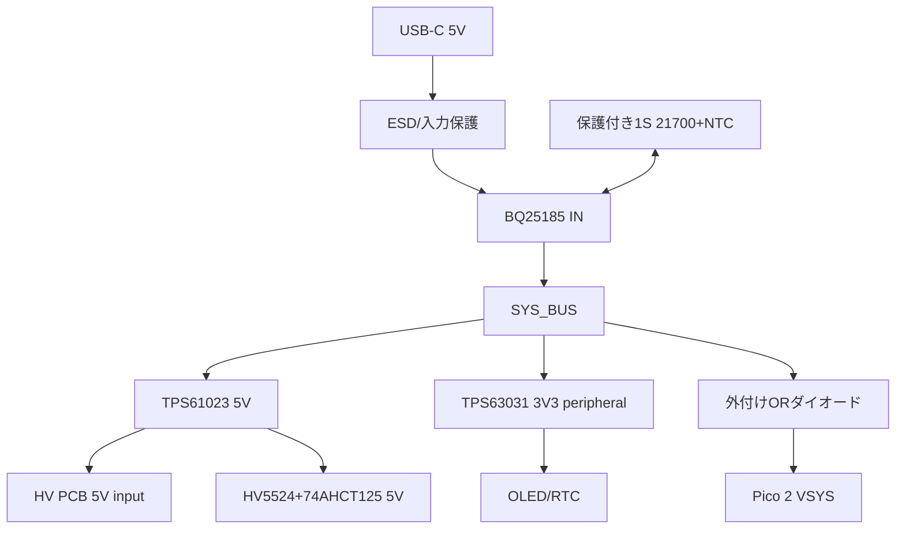

# PWR Rev.A 回路図ドラフト：ネット接続表 — v0.1
Updated: 2026-11-14 JST
Status: **SCHEMATIC DRAFT / NOT PCB-ORDER READY**. これはKiCadへ転記するための設計用接続表で、`.kicad_sch`ではない。未検証接続を「確定」と誤記しないこと。

## 0. 分割・基本ブロック
- **PWR PCB**: USB-C入力→保護→BQ25185→SYS→TPS61023(+5V) / TPS63031(+3V3)；保護付き21700＋NTC。外部Pico 2のVSYSへはSYS経由で供給。
- **HV PCB**: MAX668・トランス・独立OVP・放電・HV基板側フェイルセーフEN。PWR上には200Vを引き込まない。
- **CTRL PCB**: Pico 2・レベルシフタ・HV5524/表示・UI。B2B接続は[board-interconnects.md](board-interconnects.md)。Pico 2の内蔵USBは書込み・デバッグ用。

## 1. Net names (設計候補)
| 電源ネット | 定義/領域 |
|---|---|
| USB_VBUS_RAW | USB-C receptacle VBUS; 保護素子よりコネクタ側 |
| USB_VBUS_PROTECTED | USB入力保護後、BQ25185 IN=10 |
| CELL_BAT | **保護済みセルの出力**→BQ25185 BAT=2。PicoのBAT端子は使用しない |
| SYS_BUS | BQ25185 SYS=1。電池・USBで変動する。PicoへのSYS_TO_MCUはここから分岐 |
| +5V_PWR | TPS61023 VOUT=6、HVへ/5Vロジックへ供給（負荷スイッチ/保護の検討余地） |
| +3V3_PERIPH | TPS63031 VOUT=1、OLED/RTC用。**Pico 2の3V3(OUT)と直結しない** |
| GND | 低圧GND。配線大電流・ADC帰路・熱ビア配置をPCB上で明確化 |
| PWR_5V_EN / PWR_3V3_EN | 各DC/DCのENに適用する有効化論理。起動タイミング・デフォルトは未確定 |
| SYS_TO_MCU | SYS_BUSからPico 2 VSYSのORダイオードへ |
| HV_EN_REQ / HV_FAULT_N | CTRL↔PWR↔HVの中継。高電圧監視/遮断はHV側ハード優先 |

## 2. BQ25185 U1 — TI DLH 10-pin WSON (pin map verified)
| U1 pin | 名前 | ネット / 外付けパーツ |
|---:|---|---|
| 10 | IN | USB_VBUS_PROTECTED; CIN=1µF以上をGNDへ近接配置 |
| 1 | SYS | SYS_BUS; CSYS=10µF nominal、実効容量>=1µF（DCバイアス後） |
| 2 | BAT | CELL_BAT; CBAT=1µF以上をGNDへ |
| 5 + PAD | GND | GNDプレーン/パッド放熱設計 |
| 7 | ILIM/VSET | **18kΩ→GND案**: 4.2Vセル・500mA USB入力制限。TI設定表を回路図・選定セルと最終照合 |
| 8 | ISET | **1.2kΩ→GND案**: 250mA充電。比較用600Ω=500mA。実装後の熱/セルNTC確認 |
| 6 | TS/MR | セル密着NTCネット。**NTC値・分圧/抵抗ネットは未確定、データシート推奨回路を別紙転記**。誤ってGNDへ固定しない |
| 4 | /CE | 充電許可（active-low）。初期値と外部制御方法は未確定、無通電時/USB挿入時の挙動確認 |
| 9 | STAT1 | CHG_STAT1。適切なプルアップ（TI許容1k～20kΩ）、電圧ドメイン/逆給電対策 |
| 3 | STAT2 | CHG_STAT2。同上 |

**BLOCKER:** USB Type-C CC電流広告の処理・入力保護、TS/MR周辺回路、/CE初期値は未解決のため、この表のみから量産/発注PCBを作らない。

## 3. TPS61023 U2 — TI DRL 6-pin SOT563 (pin map verified)
| U2 pin | 名前 | ネット / 外付けパーツ |
|---:|---|---|
| 1 | FB | +5V_PWR→732kΩ→FB→100kΩ→GND。TI典型値；出力公差と安定性確認 |
| 2 | EN | PWR_5V_EN（起動条件/分圧/プル抵抗は未確定） |
| 3 | VIN | SYS_BUS。CIN=10µF nominalをGNDへ |
| 4 | GND | GND、電流帰路とFB下側の基準点を適切に接続 |
| 5 | SW | 1µH L_SWの片端、他端はSYS_BUS (VIN側)。高速ループ短く |
| 6 | VOUT | +5V_PWR。COUT=22µF×2 nominalをGNDへ |
- インダクタ暫定第一候補Würth 74438357010。メーカー個別のIsat / Irms / DCR / 高さ・JLC調達情報・温度を再検証。
- 最大負荷約1.0A時の起動・最低SYS・電流制限（典型値でなく最小値）・誘導ノイズ・温度を確認する。
- **EN=LOW時にVOUTがどうなるか/負荷切断機能**をTIの動作記述で再確認。HV電源停止はHV基板自身のHV_EN/OVPで独立に実装する。5V昇圧をOFFにすることのみでHV安全を保証しない。

## 4. TPS63031 U3 — TI DSK 10-pin WSON (pin map verified)
| U3 pin | 名前 | ネット / 外付けパーツ |
|---:|---|---|
| 1 | VOUT | +3V3_PERIPH、COUT=10µF×2 nominal |
| 2 | L2 | 1.5µHインダクタの一端 |
| 3 | PGND | 電力GND |
| 4 | L1 | 同インダクタの他端 |
| 5 | VIN | SYS_BUS、CIN=10µF nominal |
| 6 | EN | PWR_3V3_EN：起動ポリシー/プル抵抗未確定 |
| 7 | PS/SYNC | power-save時LOW、固定周波数時HIGH。初期値、EMI/軽負荷効率、デバイス定格確認 |
| 8 | VINA | SYS_BUS、0.1µF GNDへの近接バイパス |
| 9 | GND | 制御GND、適切にPGNDへ接続 |
| 10 | FB | **TPS63031固定出力品なのでVOUT=1へ接続** |
| PAD | PowerPAD | PGNDへ熱接続、メーカー推奨ランドと熱ビア |
- 部品値はTI標準アプリケーションの初期値。電流定格、実効容量、EN/PS/SYNC起動時の処理と放熱が必要。
- 3V3_PERIPHは独立電源ドメイン。Picoの3V3(OUT)との衝突を禁止し、I²Cのプルアップや無通電時GPIO電流を確認。

## 5. PWR↔CTRL / PWR↔HV の設計境界
- **PWR→Pico 2**: SYS_BUS→外付けショットキーダイオード→Pico VSYS。Picoの内蔵USB VBUS→ダイオード→VSYSと電源OR。USB側5VをPWR→Pico VBUSに直結しない。ダイオードは電流・VF・逆漏れを選別。
- **PWR→HV低圧J1（4極案）**: +5V_HV、GND、HV_EN_REQ、HV_FAULT_N（PWR側にはHV_EN/FAULTのパススルーだけ）。JST XH 4極が候補。定格電流、線材、ハーネス、誤挿入、電流帰路を確認。
- **PWR→CTRL**: SYS_TO_MCU、GND、+5V_LOGIC、+3V3_PERIPH、STATx、ADC_BAT/SYS/5V（**分圧済みのみ**）、HV_EN_REQ、HV_FAULT_N、PWR_5V_OK optional。電源と信号を別コネクタにする案。
- 高電圧出力HV_OUT/HV_RETURNをPWR配線/一般JST XHコネクタへ混ぜない。

## 6. KiCad化するときの未解決リスト (mandatory)
- [ ] BQ25185 TS/MR用**実際の電池NTC仕様/分圧回路**、/CEの起動論理、ILIM/VSET 18kΩを**Aug 2026 Rev.B**で再確認。
- [ ] USB-C端子/CC1・CC2 Rd/電流広告読み取り条件、ESD・過電流・逆極性保護の型番と接続。
- [ ] BQ25185/その他電源ICのCin/Csys/Coutの**実効容量・定格・MLCCケース**選定。
- [ ] TPS61023のインダクタ飽和・DCR・温度・出力トランジェント、EN/OFF中の電力経路。
- [ ] TPS63031のVINAとVINの給電、PS/SYNC、ENシーケンス、出力安定性と充電中ノイズ。
- [ ] Pico VSYS外付けダイオードを含むUSB同時接続、GND、I²C/ADC/STATの逆給電防止。
- [ ] BQ25185の熱ビアとGND銅箔、TPS61023高速ループ、温度/電池隔離、筐体CAD。
- [ ] コネクタ具体型番/方向/極数、TP、基板実寸、全体予算の積算。
- [ ] HV基板独立OVPとbleederの別設計、安全性の教員レビュー。

## 出典
- TI BQ25185 Rev.B (Aug 2026): https://www.ti.com/lit/ds/symlink/bq25185.pdf
- TI TPS61023 Rev.B: https://www.ti.com/lit/ds/symlink/tps61023.pdf
- TI TPS63031 product / TPS6303x datasheet: https://www.ti.com/product/TPS63031
- Raspberry Pi Pico 2 official datasheet: https://datasheets.raspberrypi.com/pico/pico-2-datasheet.pdf
- [PWR調査ノート](pwr-schematic-plan.md) / [モジュール間配線](board-interconnects.md) / [GPIO割当](pico2-pinmap.md)
