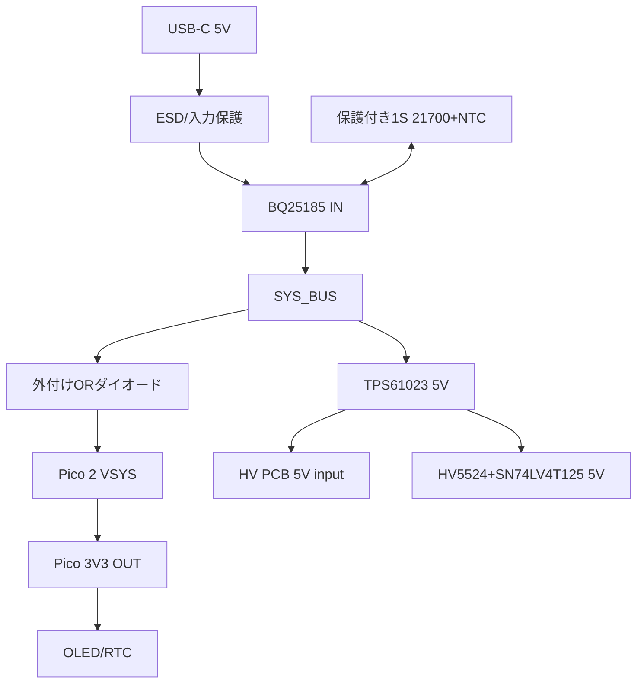

# PWR Rev.A 回路図ドラフト：ネット接続表 — v0.1

> **履歴資料。** このv0.1の`PWR_3V3_EN`、TPS63031、旧コネクタ案はPWR Rev.A v3の配線基準ではない。現行基準は[統合ネット仕様](reva-integrated-net-spec.md)と[KiCad v3回路図](../hardware/pwr/RevA-draft-v3/)で、GP17=`ADC_SENSE_EN`、J3=10極。

**電源レールの起動順序・逆給電試験は** [pwr-sequencing.md](pwr-sequencing.md) **を参照**。TPS61023はTI仕様上shutdown時のtrue disconnectionを持つ（ただし出力残留電荷・GPIO経由の逆流には別対策）。
Updated: 2026-11-14 JST
Status: **SCHEMATIC DRAFT / NOT PCB-ORDER READY**. これはKiCadへ転記するための設計用接続表で、`.kicad_sch`ではない。未検証接続を「確定」と誤記しないこと。

**Rev.A統合の優先ソース:** [reva-integrated-net-spec.md](reva-integrated-net-spec.md)。以下のTPS63031章は**代替案の履歴**であり、Rev.A基準実装では省略候補。

## 0. 分割・基本ブロック
- **PWR PCB**: USB-C入力→保護→BQ25185→SYS→TPS61023(+5V)；TPS63031(+3V3)はRev.A省略候補；保護付き21700＋NTC。外部Pico 2のVSYSへはSYS経由で供給。
- **HV PCB**: MAX668・トランス・独立OVP・放電・HV基板側フェイルセーフEN。PWR上には200Vを引き込まない。
- **CTRL PCB**: Pico 2・レベルシフタ・HV5524/表示・UI。B2B接続は[board-interconnects.md](board-interconnects.md)。Pico 2の内蔵USBは書込み・デバッグ用。

## 1. Net names (設計候補)
| 電源ネット | 定義/領域 |
|---|---|
| USB_VBUS_RAW | USB-C receptacle VBUS; 保護素子よりコネクタ側 |
| USB_VBUS_PROTECTED | USB入力保護後、BQ25185 IN=10 |
| CELL_BAT | **保護済みセルの出力**→BQ25185 BAT=2。PicoのBAT端子は使用しない |
| SYS_BUS | BQ25185 SYS=1。電池・USBで変動する。PicoへのSYS_TO_MCUはここから分岐 |
| +5V_PWR | TPS61023 VOUT=6、HVへ/5Vロジックへ供給（負荷スイッチ/保護の検討余地） |
| PICO_3V3 | Pico 2 3V3(OUT)、OLED/RTC用。TPS63031の3V3を**並列接続しない** |
| GND | 低圧GND。配線大電流・ADC帰路・熱ビア配置をPCB上で明確化 |
| PWR_5V_EN | TPS61023 EN、GP16制御。PWRでデフォルトLOW。独立3V3 ENはRev.A省略候補 |
| SYS_TO_MCU | SYS_BUSからPico 2 VSYSのORダイオードへ |
| HV_EN_REQ / HV_FAULT_N | CTRL↔PWR↔HVの中継。高電圧監視/遮断はHV側ハード優先 |

## 2. BQ25185 U1 — TI DLH 10-pin WSON (pin map verified)
| U1 pin | 名前 | ネット / 外付けパーツ |
|---:|---|---|
| 10 | IN | USB_VBUS_PROTECTED; CIN=1µF以上をGNDへ近接配置 |
| 1 | SYS | SYS_BUS; CSYS=10µF nominal、実効容量>=1µF（DCバイアス後） |
| 2 | BAT | CELL_BAT; CBAT=1µF以上をGNDへ |
| 5 + PAD | GND | GNDプレーン/パッド放熱設計 |
| 7 | ILIM/VSET | **18kΩ→GND案**: 4.2Vセル・500mA USB入力制限。TI設定表を回路図・選定セルと最終照合 |
| 8 | ISET | **1.2kΩ→GND案**: 250mA充電。比較用600Ω=500mA。実装後の熱/セルNTC確認 |
| 6 | TS/MR | セル密着NTCネット。**NTC値・分圧/抵抗ネットは未確定、データシート推奨回路を別紙転記**。誤ってGNDへ固定しない |
| 4 | /CE | 充電許可（active-low）。初期値と外部制御方法は未確定、無通電時/USB挿入時の挙動確認 |
| 9 | STAT1 | CHG_STAT1。適切なプルアップ（TI許容1k～20kΩ）、電圧ドメイン/逆給電対策 |
| 3 | STAT2 | CHG_STAT2。同上 |

**BLOCKER:** USB Type-C CC電流広告の処理・入力保護、TS/MR周辺回路、/CE初期値は未解決のため、この表のみから量産/発注PCBを作らない。

## 3. TPS61023 U2 — TI DRL 6-pin SOT563 (pin map verified)
| U2 pin | 名前 | ネット / 外付けパーツ |
|---:|---|---|
| 1 | FB | +5V_PWR→732kΩ→FB→100kΩ→GND。TI典型値；出力公差と安定性確認 |
| 2 | EN | PWR_5V_EN（起動条件/分圧/プル抵抗は未確定） |
| 3 | VIN | SYS_BUS。CIN=10µF nominalをGNDへ |
| 4 | GND | GND、電流帰路とFB下側の基準点を適切に接続 |
| 5 | SW | 1µH L_SWの片端、他端はSYS_BUS (VIN側)。高速ループ短く |
| 6 | VOUT | +5V_PWR。COUT=22µF×2 nominalをGNDへ |
- インダクタ暫定第一候補Würth 74438357010。メーカー個別のIsat / Irms / DCR / 高さ・JLC調達情報・温度を再検証。
- 最大負荷約1.0A時の起動・最低SYS・電流制限（典型値でなく最小値）・誘導ノイズ・温度を確認する。
- **EN=LOWで入力と出力が切り離される（True Disconnection）はTIの仕様で確認済み**。ただし出力コンデンサの残留電荷やGPIOなど外部経路からの逆給電は保証対象外。HV電源停止はHV基板自身のHV_EN/OVPで独立に実装する。

## 4. 旧代替案 TPS63031 U3 — Rev.Aでは原則DNP/未実装
| U3 pin | 名前 | ネット / 外付けパーツ |
|---:|---|---|
| 1 | VOUT | +3V3_PERIPH、COUT=10µF×2 nominal |
| 2 | L2 | 1.5µHインダクタの一端 |
| 3 | PGND | 電力GND |
| 4 | L1 | 同インダクタの他端 |
| 5 | VIN | SYS_BUS、CIN=10µF nominal |
| 6 | EN | PWR_3V3_EN：起動ポリシー/プル抵抗未確定 |
| 7 | PS/SYNC | power-save時LOW、固定周波数時HIGH。初期値、EMI/軽負荷効率、デバイス定格確認 |
| 8 | VINA | SYS_BUS、0.1µF GNDへの近接バイパス |
| 9 | GND | 制御GND、適切にPGNDへ接続 |
| 10 | FB | **TPS63031固定出力品なのでVOUT=1へ接続** |
| PAD | PowerPAD | PGNDへ熱接続、メーカー推奨ランドと熱ビア |
- 部品値はTI標準アプリケーションの初期値。電流定格、実効容量、EN/PS/SYNC起動時の処理と放熱が必要。
- 3V3_PERIPHは独立電源ドメイン。Picoの3V3(OUT)との衝突を禁止し、I²Cのプルアップや無通電時GPIO電流を確認。

## 5. PWR↔CTRL / PWR↔HV の設計境界
- **PWR→Pico 2**: SYS_BUS→外付けショットキーダイオード→Pico VSYS。Picoの内蔵USB VBUS→ダイオード→VSYSと電源OR。USB側5VをPWR→Pico VBUSに直結しない。ダイオードは電流・VF・逆漏れを選別。
- **PWR→HV低圧J1（4極案）**: +5V_HV、GND、HV_EN_REQ、HV_FAULT_N（PWR側にはHV_EN/FAULTのパススルーだけ）。JST XH 4極が候補。定格電流、線材、ハーネス、誤挿入、電流帰路を確認。
- **PWR→CTRL**: SYS_TO_MCU、SYS_TO_AMP（任意、SYS共通）、GND×必要本数、+5V_LOGIC、STATx、ADC_BAT/SYS/5V（**分圧済みのみ**）、PWR_5V_EN、HV_EN_REQ、HV_FAULT_N、PWR_5V_OK optional。**独立+3V3_PERIPHはRev.A基準で接続しない**。電源と信号を別コネクタにする案。
- 高電圧出力HV_OUT/HV_RETURNをPWR配線/一般JST XHコネクタへ混ぜない。

## 6. KiCad化するときの未解決リスト (mandatory)
- [ ] BQ25185 TS/MR用**実際の電池NTC仕様/分圧回路**、/CEの起動論理、ILIM/VSET 18kΩを**Aug 2026 Rev.B**で再確認。
- [ ] USB-C端子/CC1・CC2 Rd/電流広告読み取り条件、ESD・過電流・逆極性保護の型番と接続。
- [ ] BQ25185/その他電源ICのCin/Csys/Coutの**実効容量・定格・MLCCケース**選定。
- [ ] TPS61023のインダクタ飽和・DCR・温度・出力トランジェント、EN/OFF中の電力経路。
- [ ] Pico 3V3(OUT)からOLED/RTCを給電する外部負荷・待機電流と、PicoのみUSB給電時の逆給電を確認。TPS63031を将来使用する場合は別設計。
- [ ] Pico VSYS外付けダイオードを含むUSB同時接続、GND、I²C/ADC/STATの逆給電防止。
- [ ] BQ25185の熱ビアとGND銅箔、TPS61023高速ループ、温度/電池隔離、筐体CAD。
- [ ] コネクタ具体型番/方向/極数、TP、基板実寸、全体予算の積算。
- [ ] HV基板独立OVPとbleederの別設計、安全性の教員レビュー。

## 出典
- TI BQ25185 Rev.B (Aug 2026): https://www.ti.com/lit/ds/symlink/bq25185.pdf
- TI TPS61023 Rev.B: https://www.ti.com/lit/ds/symlink/tps61023.pdf
- TI TPS63031 product / TPS6303x datasheet: https://www.ti.com/product/TPS63031
- Raspberry Pi Pico 2 official datasheet: https://datasheets.raspberrypi.com/pico/pico-2-datasheet.pdf
- [PWR調査ノート](pwr-schematic-plan.md) / [モジュール間配線](board-interconnects.md) / [GPIO割当](pico2-pinmap.md)

## 7. BQ25185 TS/MR・USB-C入力保護の具体化（2026-11-14）

**ステータス：メーカー仕様に根拠を持つ回路候補。部品型番/USB入力保護を実装確定したわけではない。**

### セル温度NTC
- **BQ25185 TS/MR (U1 pin6) → 10kΩ @25°C, B(25/85)=3435KのNTC → GND** がメーカー標準構成。NTCを**セル表面へ熱結合**し、充電ICやコイルの温度を測る場所には置かない。TI内蔵のTSバイアスを利用するためメーカー典型構成のNTCに外部プルアップ抵抗を足さない。
- 10kΩ NTCのメーカー型番・温度精度・端子/ケーブル長・セル貼付材料・耐熱定格は未確定。保護付き21700セルに既設NTCがある場合は**B定数/常温値と保護回路との電気的共用可否**を確認し、単純に並列接続しない。
- TS/MRが所定のcold/hot比較器閾値を越えると充電が停止し安全タイマも停止。異なるB定数では実際の停止温度が変わるため補正抵抗と閾値の再計算が必要。
- **TS/MRはMRファクトリーモード入力を兼用**する。意図しない長時間LOWでfactory modeに入らないよう、NTCケーブルの短絡/断線/押しボタン併設/基板洗浄残渣を検討。特にGNDへ固定するダミー抵抗で温度保護を**意図的に無効化しない**。
- メーカーのNTC故障検出に加えて、実セル温度を同時測定し、電池メーカーの充電温度範囲より安全側の停止条件を設定する。BQ25185のTS保護は**セルパックの保護回路の代用ではない**。
- 一次資料: TI SLUSF65B (Aug 2026), External NTC Monitoring §8.3.9 / Typical Application Fig 7-1 https://www.ti.com/lit/ds/symlink/bq25185.pdf

### USB-C受電・入力保護
- 既存 GCT USB4105-GF-A を暫定候補とし、**CC1→Rd 5.1kΩ→GND、CC2→別のRd 5.1kΩ→GND**。VbusとGNDをBQ25185 INへ配線。USB-Cの入力電流広告/USB規則の判定なしにBQ25185のILIMを1100mAへ固定してはいけない。
- **初期仕様はUSB-C 5V/500mA相当までを評価対象**。PC USB2.0の既定電流と接続元USB-CアダプターのCC情報/認識状態は異なる場合がある。500mAがいかなる接続先でも自動で保証されるわけではない。USB 2.0の列挙状況やType-C電流広告に整合する制御を要検討。
- **CC電流検知が必要な拡張案**: TI TUSB320 (USB Type-C UFP/DRP CC検出, GPIO/I²CでDefault/1.5A/3A広告を検出)。ただしBQ25185のILIM/VSETは充電終止電圧も設定するため、マイコンで単純に抵抗値を切替えて電流能力に追従する方法は**充電電圧への誤影響・起動/停止挙動を含む再設計が必要**。現時点で追加採用しない。
- **ESD（信号）候補**: TI TPD4E05U06等のUSB Type-C用低容量ESD保護。CC1/CC2、USBデータを使う場合はD+/D-、USB挿抜への保護を検討し、コネクタ近傍に配置。**5.5V Vrwmの信号ESDデバイスは、VBUS過電圧遮断やヒューズではない**。正式な保護対象ピン、クランプ電圧と接続を確認。
- **入力パワー保護候補**: TI TPS2595系eFuse。過電流制限、UVLO/OVP、突入制御、過熱保護が可能。ただし**全てのTPS2595枝番でUSB 5Vに適切なOVP閾値とは限らない**ため、具体型番の可変OVLO/クランプ閾値・ILIM・漏れ電流・入力5V時の動作、BQ25185のIN入力保護との重複・価格/手実装性を比較してから採用判断。
- TI BQ25185そのものにINPUT OVP、入力電流制限、充電熱制御があり、eFuseは必須と断定できない。一方、**VBUS ESD、物理的な短絡、コネクタ側パターン/ケーブルの電流、誤配線、異常USB供給**に対する保護範囲を区別し、必要ならeFuse/ヒューズを追加。受電5VでのTPS2595の必要性は機能重複と価格を比較して保留。
- USB-C receptacleのシールド接地、USBデータ線を使うか（Picoのデバッグ用USBとは分離）、USB電源の逆流経路、CC配線の静電気放電、TVSの戻り経路、負荷側CINの突入を配線図で確認する。
- 一次資料：TI TUSB320 https://www.ti.com/product/TUSB320 ; TI TPS2595 https://www.ti.com/product/TPS2595 ; TI TPD4E05U06 https://www.ti.com/product/TPD4E05U06

### Rev.A作図前の判断ゲート
1. **電池NTCの現物型番を先に指定**し、10kΩ@25°C B=3435Kを保証するか確認。温度しきい値、TS/MRの短絡・断線時挙動を実験計画に明記。
2. USB-C 5V入力の使用条件を「単純な充電器専用」か「PC USBのデータ/列挙を含む」か明文化し、USB規則との適合性をレビュー。今は500mAで保守的評価。
3. CC用ESD/シールド、VBUS入力保護、BQ25185 IN前のショート/サージ保護の実装部品は**価格・定格・JLC実装・基板面積**の比較後に採否を決める。
4. NTC接続、USB異常、VBUS入力定格、BQ25185熱/充電保護のテストを、実セルを危険に晒さずダミー負荷・NTC模擬抵抗で先に実施。
