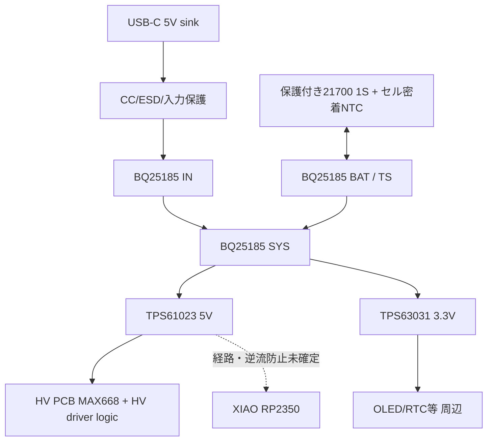

# PWRモジュール回路図設計ノート — Draft v0.1
Updated: 2026-11-14 JST
Status: PROPOSED / TO_VERIFY — **KiCad実配線前のブロック接続設計**。メーカー定数、熱、電池規格、充電動作、電源切替、PCBは未検証。

## 目的
BQ25185のPower Pathから周辺3.3V、HV向け5Vを供給し、XIAO RP2350を安全に給電する。試作PWR基板を合格後そのまま完成品に搭載できる構成を目指す。

## 1. トポロジー（論理接続）

- これは**回路図そのものではない**。電源経路の損失、保護、シーケンス、USB-C広告電流検出、コネクタ実装は未確定。

## 2. BQ25185：メーカー仕様に沿ったネット表
| ピン（10pin WSON DLH） | ネット | 必要処理・評価 |
|---|---|---|
| IN=10 | USB_PROTECTED_5V | IN-GND 1uF以上のバイパス、USB ESD/保護と配線の確認 |
| SYS=1 | SYS | SYS-GND 10uF以上のセラミック、**DCバイアス時の実効容量1uF以上**、5V/3.3Vレールへ |
| BAT=2 | CELL_PLUS | BAT-GND 1uF以上、保護付きセルとセル専用の温度センシング、逆挿入保護の要否 |
| GND=5 + exposed pad | GND | メーカー推奨の放熱ビアとGND面、充電時の熱計算 |
| TS/MR=6 | CELL_TS | セル密着NTCの抵抗値、分圧/電流源のデータシート回路、誤検出・factory modeを検証 |
| ILIM/VSET=7 | ILIM_VSET_CFG | **入力電流制限と終止電圧の両設定が関わる**。セル定格に対応する4.2V等と100/500/1100mAを同時に設定する抵抗を公式表で選ぶ |
| ISET=8 | ICHG_CFG | 250/500mA充電候補に対応する抵抗を公式式で計算。充電熱の実測前に1A採用しない |
| /CE=4 | CHARGE_EN_N | active-low：Lowで充電許可、Highで停止。MCU不在/初期化時のデフォルトを要定義 |
| STAT1=9, STAT2=3 | CHG_STAT1/2 | オープンドレイン、適切なプルアップ（TI: 1k～20kΩの範囲）とMCU入力閾値、電源OFF時逆流を検証 |
| Thermal pad | GND | WSONパッドの熱設計は必須 |

**一次資料:** TI BQ25185 Rev.B (Aug 2026) https://www.ti.com/lit/ds/symlink/bq25185.pdf

## 3. 5V / 3.3V DC-DCレール
- **TPS61023**をSYS→5Vの候補とする（VIN 0.5–5.5V、起動時1.8V以上、典型電流制限3.7A、5V/1.5A@3.6V入力時94%参考効率）。リミットは保証出力電流でない。インダクタ、入力/出力容量、FB抵抗、出力リップル、EN/UVLO、SW配線と温度をメーカー推奨回路に基づいて確定する。https://www.ti.com/product/TPS61023
- **TPS63031**をSYS→3.3V周辺電源の候補とする（VIN 1.8–5.5V、3.3V固定、昇圧時の出力公称上限参考約500mA@VIN>2.4V）。XIAOの3V3へ無条件で給電しない。https://www.ti.com/product/TPS63031
- 200V×16mAのHV最大ストレス負荷=3.2W、MAX668効率70%仮定→5V側0.914A。5Vロジック等0.5W仮定なら5V合計約1.014A、TPS61023 85%仮定・SYS3.3VならSYSから約1.81A。**これは起動突入・外部負荷・熱・電源配線の設計値ではない**。

## 4. XIAO RP2350：要注意事項
- Seeed公式Pin Map：**5V=VBUS（Power Input/Output）**、**3V3=3V3_OUT（Power Output）**。専用内蔵USB充電IC SGM40567およびBAT padが存在する。https://wiki.seeedstudio.com/xiao_rp2350_arduino/ ; https://files.seeedstudio.com/wiki/XIAO-RP2350/res/Seeed-Studio-XIAO-RP2350-v1.0.pdf
- **外部PWRの5VをXIAO 5V/VBUSへ直結し、同時にPC USBを挿す運用は回路確認なしに禁止**（電源逆流、USB VBUS誤印加、XIAO内蔵充電経路への給電の可能性）。
- XIAOのBAT padをBQ25185 BATへつないだり、外部TPS63031の3.3VをXIAO 3V3へ直結することも未承認。
- **実装選択肢**：(A) XIAOは試作用として独立USB給電、PWRはパワー負荷の試験に限定。(B) 完成品ではメーカー回路図に照らして5V給電の逆流ブロック/切替を設計。(C) 完成版ではRP2350チップ直接実装を含め、コスト・作業量・USBプログラミング経路で比較。
- 5V入力とUSBデータ線を同時接続する際の全電源経路・MOSFETボディダイオード・3.3V逆流・MCU GPIOのパワーシーケンスをレビューするまでピン配線は確定しない。

## 4A. XIAO RP2350公式回路図の実配線確認（2026-11-14）

**確認元**: Seeed公式 XIAO RP2350 v1.0 回路図（/03 Power/, PDF p.4, /04 RP2350 p.5） https://files.seeedstudio.com/wiki/XIAO-RP2350/res/Seeed-Studio-XIAO-RP2350-v1.0.pdf 。異なるXIAO製品の仕様を流用しない。

### 実際のネット
- **XIAOヘッダ5Vピン(14)は VBUS**。USB-CコネクタのVBUS、内蔵リニア充電IC SGM40567 U3 VINと**同一の電気ネット**。内部回路の「+5V」はVBUSとは**別のネット**で、D1ショットキーやQ1 P-MOSを介して+3V3 DC-DCを駆動。外部5Vをヘッダに供給するとU3充電ICにも5Vがかかる。
- **XIAOヘッダ3V3ピン(13)は +3V3 出力**（U1 SGM6029の3.3V出力）。PWR側TPS63031の+3V3_PERIPHをそのままXIAOの3V3へ直結しない。
- **XIAO BAT pad=VBAT** は内蔵SGM40567のBAT出力とQ1の電池側に直結。BQ25185 BATまたはSYSに直結しない（充電IC二重化・予期しない電流経路）。
- XIAOの充電IC SGM40567のR10=150kΩ、公式回路図コメントは **Icharge=160mA**。XIAOとBQ25185で同一電池の充電制御をさせない。
- XIAOのヘッダ5Vは**VBUSラベル**であり、USBプラグによって本体PWR 5VとPC側のUSB 5Vがそのまま合流しうる。普通の5V電源スイッチ/ショットキー/電源MUXだけでXIAO上の内蔵チャージャ配線まで隔離できるとは限らない。

### 推奨案（製品と開発で段階を分ける）
**暫定案 A（XIAOを維持して検証）**:
1. PWRの+5V_LOGIC→**逆流防止付き入力経路またはpower MUX**→XIAO 5Vヘッダに供給。設計確認ができるまでUSB接続との同時駆動はしない。XIAOのBAT padは使用しない。
2. XIAOのUSBは試作時には書き込みに用いる。ただしPWR電源を切り離し、周辺GPIOからの逆給電も防ぐ。再プログラミングで毎回切替える負担と完成品USB口の取り回しに注意。
3. **書込み時にもPWRから給電したい場合**は、PC USBとPWR 5Vの両方の逆流防止、内蔵充電ICの動作、入力/出力の電圧条件が満たされた専用回路を設計・実測した場合のみ可。Seeed一般記事 https://www.seeedstudio.com/blog/2025/11/24/designing-a-xiao-expansion-board-using-a-schottky-diode-to-prevent-power-backfeeding/ の単一ショットキー例は、この製品の完全検証を意味しない。
4. 具体的なスイッチ/コネクタ定数と操作方法は**未確定**。設計採用前にUSB接続、電池動作、VBUS無電源の各ケースで電流経路を回路図追跡する。

**比較案 B（内蔵充電ICのないMCUモジュール）**:
- 電池充電をBQ25185一つへ集約し、USBと外部SYSの切替が基板設計として公開されているRP2350モジュール（Raspberry Pi Pico 2等）と比較する。Pico 2は大きくなるため、筐体・GPIO・USB引出し・消費電力・コストを比較しないまま採用とはしない。
- 最終的な制御PCBが小型化必須ならRP2350チップ直接実装も比較可能。ただし発振・フラッシュ・USB・製造難易度が増えるので期限と予算の観点では最後の手段。

### 結論/設計ゲート
- XIAOは**ソフト開発用として引き続き採用可**だが、PWRに同居させる給電方法はまだ未確定。
- **XIAOの5Vへ5Vブーストを無条件接続、XIAOのBATへセル接続、XIAO 3V3へ外部3.3V供給はKiCad上で禁止**。
- PWRを製品再利用モジュールとして固定したいなら、MCUモジュールの給電仕様が確認できた時点でPWR↔CTRLのコネクタ信号・USB書込方法を確定する。
- 試作時に実際の5Vピン電圧・XIAO+3V3・USB未接続時漏れ電流・USB同時接続時電流・充電器の不意動作を測定。外部USBと外部5Vが直結しない設計を回路図と実機の両方で確認する。

## 5. USB-Cと電池の最低限の回路検討
- USB Type-C 5V sinkのCC1/CC2にそれぞれRd=5.1kΩ（型番/許容差とソース電流広告は別途仕様整合）、ESD/過電流/サージ・保護を検討。BQ25185への1100mA入力設定はCC広告またはUSB仕様に基づいた能力確認なしでは禁止。
- Li-ionセルは**保護付き製品**を前提とし、充電電圧4.2Vを想定する場合はセル仕様とILIM/VSETを適合させる。BQ25185は保護付きセル自体を代替しない。
- 専用セルNTCの配置と抵抗定数は、BQ25185 TS/MR方式をTI公式回路で確認し、セル温度だけでなく充電IC基板温度も測る。
- SYS電圧、BAT電圧、USB VBUS、5V、3.3V、充電/放電電流の測定端子（シャントは電源損失を増すため試験条件を分離）を確保。
- BQ25185の工場モード、長押しMR、充電/電池不足時の起動条件を確認。

## 6. 発注用KiCad確定前のゲート
1. **BQ25185のILIM/VSETとISET抵抗の公式式・対応表**から、保護付き21700の電圧、USB入力制限500mA、充電250/500mAの両立を計算。
2. **XIAOへの給電**を内蔵充電ICとUSBデバッグ時の同時電源を含め、Seeed回路図でトランジスタ/ダイオード単位に確認。
3. TPS61023の3V近辺の入力・1A超出力について、インダクタピーク、SW current limit最小値、効率、温度、入力配線を計算。
4. TPS63031の必要3.3V負荷、効率、EN状態、放電を評価。
5. 充電時とHV負荷時の熱、USB入力制限、cell NTCとPETG密閉条件のgo/no-go。
6. コネクタ型番・GPIO・UVLO・抵抗コンデンサ定格、KiCad footprintとJLCPCBの実際の購買/実装可能性を確認。

関連: [module-interfaces.md](module-interfaces.md) / [power-state-machine.md](power-state-machine.md) / [components.md](components.md)
