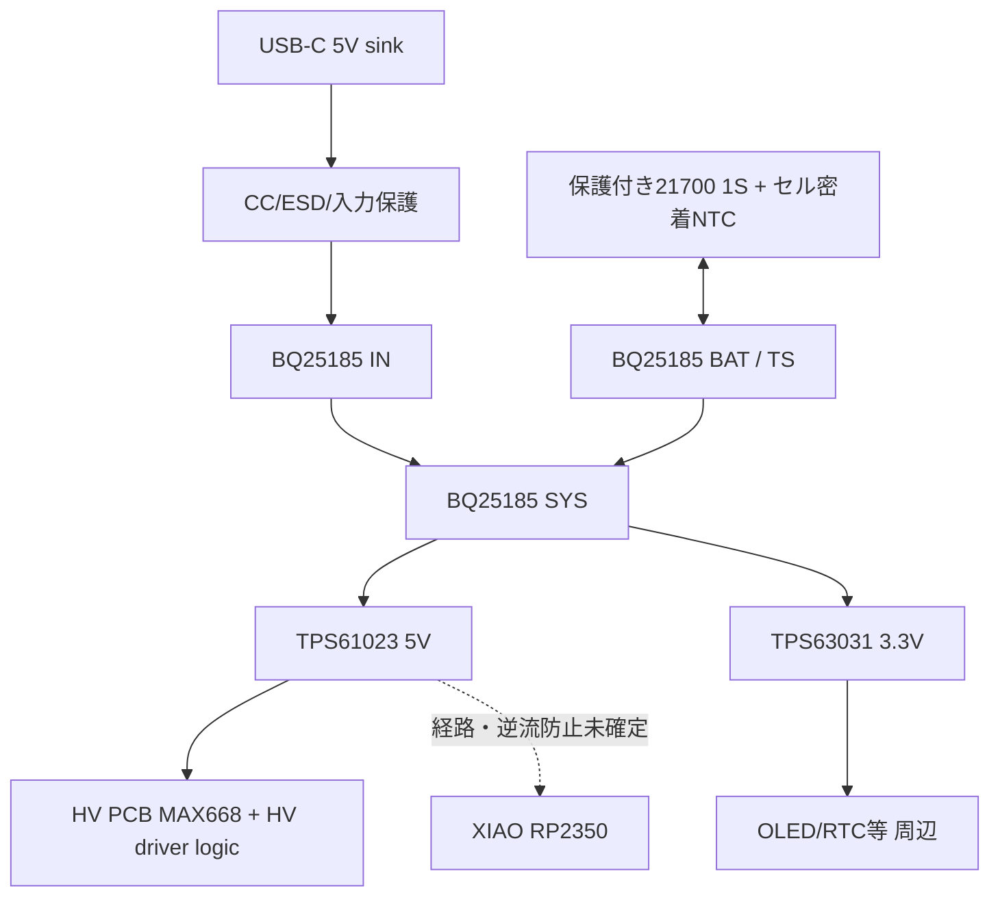

# PWRモジュール回路図設計ノート — Draft v0.1
Updated: 2026-11-14 JST
Status: PROPOSED / TO_VERIFY — **KiCad実配線前のブロック接続設計**。メーカー定数、熱、電池規格、充電動作、電源切替、PCBは未検証。

## 目的
BQ25185のPower Pathから周辺3.3V、HV向け5Vを供給し、XIAO RP2350を安全に給電する。試作PWR基板を合格後そのまま完成品に搭載できる構成を目指す。

## 1. トポロジー（論理接続）

- これは**回路図そのものではない**。電源経路の損失、保護、シーケンス、USB-C広告電流検出、コネクタ実装は未確定。

## 2. BQ25185：メーカー仕様に沿ったネット表
| ピン（10pin WSON DLH） | ネット | 必要処理・評価 |
|---|---|---|
| IN=10 | USB_PROTECTED_5V | IN-GND 1uF以上のバイパス、USB ESD/保護と配線の確認 |
| SYS=1 | SYS | SYS-GND 10uF以上のセラミック、**DCバイアス時の実効容量1uF以上**、5V/3.3Vレールへ |
| BAT=2 | CELL_PLUS | BAT-GND 1uF以上、保護付きセルとセル専用の温度センシング、逆挿入保護の要否 |
| GND=5 + exposed pad | GND | メーカー推奨の放熱ビアとGND面、充電時の熱計算 |
| TS/MR=6 | CELL_TS | セル密着NTCの抵抗値、分圧/電流源のデータシート回路、誤検出・factory modeを検証 |
| ILIM/VSET=7 | ILIM_VSET_CFG | **入力電流制限と終止電圧の両設定が関わる**。セル定格に対応する4.2V等と100/500/1100mAを同時に設定する抵抗を公式表で選ぶ |
| ISET=8 | ICHG_CFG | 250/500mA充電候補に対応する抵抗を公式式で計算。充電熱の実測前に1A採用しない |
| /CE=4 | CHARGE_EN_N | active-low：Lowで充電許可、Highで停止。MCU不在/初期化時のデフォルトを要定義 |
| STAT1=9, STAT2=3 | CHG_STAT1/2 | オープンドレイン、適切なプルアップ（TI: 1k～20kΩの範囲）とMCU入力閾値、電源OFF時逆流を検証 |
| Thermal pad | GND | WSONパッドの熱設計は必須 |

**一次資料:** TI BQ25185 Rev.B (Aug 2026) https://www.ti.com/lit/ds/symlink/bq25185.pdf

## 3. 5V / 3.3V DC-DCレール
- **TPS61023**をSYS→5Vの候補とする（VIN 0.5–5.5V、起動時1.8V以上、典型電流制限3.7A、5V/1.5A@3.6V入力時94%参考効率）。リミットは保証出力電流でない。インダクタ、入力/出力容量、FB抵抗、出力リップル、EN/UVLO、SW配線と温度をメーカー推奨回路に基づいて確定する。https://www.ti.com/product/TPS61023
- **TPS63031**をSYS→3.3V周辺電源の候補とする（VIN 1.8–5.5V、3.3V固定、昇圧時の出力公称上限参考約500mA@VIN>2.4V）。XIAOの3V3へ無条件で給電しない。https://www.ti.com/product/TPS63031
- 200V×16mAのHV最大ストレス負荷=3.2W、MAX668効率70%仮定→5V側0.914A。5Vロジック等0.5W仮定なら5V合計約1.014A、TPS61023 85%仮定・SYS3.3VならSYSから約1.81A。**これは起動突入・外部負荷・熱・電源配線の設計値ではない**。

## 4. XIAO RP2350：要注意事項
- Seeed公式Pin Map：**5V=VBUS（Power Input/Output）**、**3V3=3V3_OUT（Power Output）**。専用内蔵USB充電IC SGM40567およびBAT padが存在する。https://wiki.seeedstudio.com/xiao_rp2350_arduino/ ; https://files.seeedstudio.com/wiki/XIAO-RP2350/res/Seeed-Studio-XIAO-RP2350-v1.0.pdf
- **外部PWRの5VをXIAO 5V/VBUSへ直結し、同時にPC USBを挿す運用は回路確認なしに禁止**（電源逆流、USB VBUS誤印加、XIAO内蔵充電経路への給電の可能性）。
- XIAOのBAT padをBQ25185 BATへつないだり、外部TPS63031の3.3VをXIAO 3V3へ直結することも未承認。
- **実装選択肢**：(A) XIAOは試作用として独立USB給電、PWRはパワー負荷の試験に限定。(B) 完成品ではメーカー回路図に照らして5V給電の逆流ブロック/切替を設計。(C) 完成版ではRP2350チップ直接実装を含め、コスト・作業量・USBプログラミング経路で比較。
- 5V入力とUSBデータ線を同時接続する際の全電源経路・MOSFETボディダイオード・3.3V逆流・MCU GPIOのパワーシーケンスをレビューするまでピン配線は確定しない。

## 4A. XIAO RP2350公式回路図の実配線確認（2026-11-14）

**確認元**: Seeed公式 XIAO RP2350 v1.0 回路図（/03 Power/, PDF p.4, /04 RP2350 p.5） https://files.seeedstudio.com/wiki/XIAO-RP2350/res/Seeed-Studio-XIAO-RP2350-v1.0.pdf 。異なるXIAO製品の仕様を流用しない。

### 実際のネット
- **XIAOヘッダ5Vピン(14)は VBUS**。USB-CコネクタのVBUS、内蔵リニア充電IC SGM40567 U3 VINと**同一の電気ネット**。内部回路の「+5V」はVBUSとは**別のネット**で、D1ショットキーやQ1 P-MOSを介して+3V3 DC-DCを駆動。外部5Vをヘッダに供給するとU3充電ICにも5Vがかかる。
- **XIAOヘッダ3V3ピン(13)は +3V3 出力**（U1 SGM6029の3.3V出力）。PWR側TPS63031の+3V3_PERIPHをそのままXIAOの3V3へ直結しない。
- **XIAO BAT pad=VBAT** は内蔵SGM40567のBAT出力とQ1の電池側に直結。BQ25185 BATまたはSYSに直結しない（充電IC二重化・予期しない電流経路）。
- XIAOの充電IC SGM40567のR10=150kΩ、公式回路図コメントは **Icharge=160mA**。XIAOとBQ25185で同一電池の充電制御をさせない。
- XIAOのヘッダ5Vは**VBUSラベル**であり、USBプラグによって本体PWR 5VとPC側のUSB 5Vがそのまま合流しうる。普通の5V電源スイッチ/ショットキー/電源MUXだけでXIAO上の内蔵チャージャ配線まで隔離できるとは限らない。

### 推奨案（製品と開発で段階を分ける）
**暫定案 A（XIAOを維持して検証）**:
1. PWRの+5V_LOGIC→**逆流防止付き入力経路またはpower MUX**→XIAO 5Vヘッダに供給。設計確認ができるまでUSB接続との同時駆動はしない。XIAOのBAT padは使用しない。
2. XIAOのUSBは試作時には書き込みに用いる。ただしPWR電源を切り離し、周辺GPIOからの逆給電も防ぐ。再プログラミングで毎回切替える負担と完成品USB口の取り回しに注意。
3. **書込み時にもPWRから給電したい場合**は、PC USBとPWR 5Vの両方の逆流防止、内蔵充電ICの動作、入力/出力の電圧条件が満たされた専用回路を設計・実測した場合のみ可。Seeed一般記事 https://www.seeedstudio.com/blog/2025/11/24/designing-a-xiao-expansion-board-using-a-schottky-diode-to-prevent-power-backfeeding/ の単一ショットキー例は、この製品の完全検証を意味しない。
4. 具体的なスイッチ/コネクタ定数と操作方法は**未確定**。設計採用前にUSB接続、電池動作、VBUS無電源の各ケースで電流経路を回路図追跡する。

**比較案 B（内蔵充電ICのないMCUモジュール）**:
- 電池充電をBQ25185一つへ集約し、USBと外部SYSの切替が基板設計として公開されているRP2350モジュール（Raspberry Pi Pico 2等）と比較する。Pico 2は大きくなるため、筐体・GPIO・USB引出し・消費電力・コストを比較しないまま採用とはしない。
- 最終的な制御PCBが小型化必須ならRP2350チップ直接実装も比較可能。ただし発振・フラッシュ・USB・製造難易度が増えるので期限と予算の観点では最後の手段。

### 結論/設計ゲート
- XIAOは**ソフト開発用として引き続き採用可**だが、PWRに同居させる給電方法はまだ未確定。
- **XIAOの5Vへ5Vブーストを無条件接続、XIAOのBATへセル接続、XIAO 3V3へ外部3.3V供給はKiCad上で禁止**。
- PWRを製品再利用モジュールとして固定したいなら、MCUモジュールの給電仕様が確認できた時点でPWR↔CTRLのコネクタ信号・USB書込方法を確定する。
- 試作時に実際の5Vピン電圧・XIAO+3V3・USB未接続時漏れ電流・USB同時接続時電流・充電器の不意動作を測定。外部USBと外部5Vが直結しない設計を回路図と実機の両方で確認する。

## 4B. MCUモジュール比較・Pico 2を第一候補に変更（2026-11-14）

**判断:** 完成品の制御モジュールは**Raspberry Pi Pico 2（無線なし）を暫定第一候補**とする。XIAO RP2350は小型化代替案・手持ち開発用候補として残す。筐体寸法・購入価格・待機電流・GPIO実配線が未確定で、部品発注確定ではない。

| 候補 | サイズ | 取り出せるGPIO | 電池充電IC | 外部給電/USB併用の難易度 | 評価 |
|---|---|---|---|---|---|
| Raspberry Pi Pico 2 | 51×21mm | 26 | なし | **VSYSがVBUSと分離済み、公式ORing回路あり** | **第一候補** |
| Seeed XIAO RP2350 | 21×17.8mm | 19（裏パッド含む） | SGM40567 | **5Vヘッダ=VBUS、BAT=充電出力**。BQ25185と競合する | 小型代替 |
| Waveshare RP2350-Zero | メーカー寸法図で確認 | ヘッダ20+パッド9 | なし | 3.3V LDO、USB/外部電源の逆流経路とコネクタ定格を個別確認 | 小型代替 |

一次資料：Pico 2 datasheet https://datasheets.raspberrypi.com/pico/pico-2-datasheet.pdf （Figure 8: External supply via diode to VSYS、Figure 9: P-MOS option）、製品概要 https://www.raspberrypi.com/documentation/microcontrollers/pico-series.html 、XIAO https://wiki.seeedstudio.com/xiao_rp2350_arduino/ 、Waveshare https://www.waveshare.com/wiki/RP2350-Zero 。

### Pico 2暫定電源接続案
- **BQ25185 SYS → 外付けショットキー（アノードSYS/カソードPico VSYS）→ Pico 2 VSYS**。Pico 2基板に内蔵されているUSB VBUS→D1→VSYSダイオードとダイオードORとなり、USBと外部SYSの相互逆流を防ぐ（詳細は公式Pico 2 datasheet Figure 8）。
- **Pico 2 VBUSへPWR基板5Vを接続しない**。USBコネクタはプログラミング用に残す。
- VSYSはPico 2の動作電圧仕様（公称1.8–5.5V）と外付けダイオード降下の後でも最低電圧を満たす。BQ25185 SYSの全モードの最低・最大、USB未接続/USB接続時電源優先関係をメーカー仕様で確認。
- **USBデータGNDと本体PWR GNDは接続する**。電源ダイオードORは絶縁ではない。USB接続中のPWRの電源補完とBQ25185 chargerの動作を別途検証する。
- Pico 2 GPIOは3.3V。HV5524の5V入力には74AHCT125を残し、レベルシフタの電源OFF時のGPIO逆給電を確認。
- **Pico 2の3V3出力とPWRのTPS63031 3.3Vレールを直結しない**。I²C pull-up、電源シーケンスとGPIOクランプ電流をレビュー。
- 新しい**PWR→CTRL**電気インターフェース案は SYS_TO_MCU, GND, PWR_3V3_PERIPH（別系統）、STAT等。Picoのためだけの5V_LOGICは不要だが、74AHCT125/HV5524用5Vは引き続き必要。
- **再試作を減らす観点**：Pico 2はPWR PCBから切り離し可能な制御PCBに装着。51mm×21mmが台座に収まるか3D模型で先に検証。厳しい場合のみRP2350-Zeroを再評価。

### GPIO概算（確定配線表ではない）
- HV5524 serial: DATA, CLK, LE, BL = 4
- I2C OLED + RTC = 2
- UI: ACTION 1, NEXT左右2, ENCODER A/B/SW 3 = 6
- HV_EN 1、AUDIO 1、電源監視用GPIO/ADC 2〜4 = 計16〜18程度。Pico 2の26 GPIOに予備はあるが、機能ごとの端子配置は要検証。
- ニキシー2桁20カソード + ネオン12カソードはHV5524側32出力であってPico 2の32 GPIOを必要としない。

### 発注前の残件
1. SYS実電圧の下限/上限とPico 2 VSYS動作範囲、ショットキー損失、PWR/GND配線。
2. USB接続・取り外し時のVSYS/3V3波形、片方からの逆給電とGPIO逆流、MCUの誤リセット有無。
3. 51×21mm＋USBコネクタ・ピン・曲げ半径を台座に収容できること。
4. Pico 2の通常/休止電流とタイマー稼働時間、XIAO/Zeroとの価格差、現物調達先。
5. PWRのスタンドアロン給電とPico 2デバッグUSB併用の正式な操作手順。

## 5. USB-Cと電池の最低限の回路検討
- USB Type-C 5V sinkのCC1/CC2にそれぞれRd=5.1kΩ（型番/許容差とソース電流広告は別途仕様整合）、ESD/過電流/サージ・保護を検討。BQ25185への1100mA入力設定はCC広告またはUSB仕様に基づいた能力確認なしでは禁止。
- Li-ionセルは**保護付き製品**を前提とし、充電電圧4.2Vを想定する場合はセル仕様とILIM/VSETを適合させる。BQ25185は保護付きセル自体を代替しない。
- 専用セルNTCの配置と抵抗定数は、BQ25185 TS/MR方式をTI公式回路で確認し、セル温度だけでなく充電IC基板温度も測る。
- SYS電圧、BAT電圧、USB VBUS、5V、3.3V、充電/放電電流の測定端子（シャントは電源損失を増すため試験条件を分離）を確保。
- BQ25185の工場モード、長押しMR、充電/電池不足時の起動条件を確認。

## 6. 発注用KiCad確定前のゲート
1. **BQ25185のILIM/VSETとISET抵抗の公式式・対応表**から、保護付き21700の電圧、USB入力制限500mA、充電250/500mAの両立を計算。
2. **XIAOへの給電**を内蔵充電ICとUSBデバッグ時の同時電源を含め、Seeed回路図でトランジスタ/ダイオード単位に確認。
3. TPS61023の3V近辺の入力・1A超出力について、インダクタピーク、SW current limit最小値、効率、温度、入力配線を計算。
4. TPS63031の必要3.3V負荷、効率、EN状態、放電を評価。
5. 充電時とHV負荷時の熱、USB入力制限、cell NTCとPETG密閉条件のgo/no-go。
6. コネクタ型番・GPIO・UVLO・抵抗コンデンサ定格、KiCad footprintとJLCPCBの実際の購買/実装可能性を確認。

関連: [module-interfaces.md](module-interfaces.md) / [power-state-machine.md](power-state-machine.md) / [components.md](components.md)

## 6A. メーカー典型回路から抽出した周辺定数（2026-11-14）

**ステータス: PROPOSED / NOT ORDER-READY**。以下はメーカーPDFの標準アプリケーションまたは計算から得た*初期検討値*。標準推奨値と、NIXIDORO実機での動作・熱・容量ディレーティング保証は別物。

### BQ25185（TI SLUSF65B, revised Aug 2026）
- **ILIM/VSET: 18kΩ → VBATREG 4.2V + USB入力電流制限500mA**（TIの設定表/設計例）。電池セルの4.2V定格・USB利用条件に適合する場合に限る。5V/500mA入力と500mA充電は同時負荷時に充電電流低減される。
- **ISET:** RISET = KISET / ICHG, KISET typical 300 AΩ。250mA→1.2kΩ、500mA→600Ω、データシートの設計例300mA→1kΩ。**250mAを初回実装の第一候補**、500mAは基板のパッド/交換評価候補（充電中の抵抗ホットスワップ運用は要注意）。1%精度以上を目安とし熱試験を実施。
- **CIN >=1µF / CSYS: nominal 10µF (メーカー範囲1–100µF) / CBAT >=1µF**。製造容量ではなく、DCバイアス・温度・公差・経年後の**実効容量**がメーカー要求を満たすこと。IN/SYSはTIが25V定格X5R/X7Rを推奨。実装サイズは選定したMLCCデータシートで確認。
- NTCは選んだ電池仕様とTS/MRピンのTI推奨回路を照合。定数未確定。STAT1/STAT2と/CEの無通電時のデフォルト状態も未確定。
- 資料: https://www.ti.com/lit/ds/symlink/bq25185.pdf 7.2.2およびISET Pin Detection。

### TPS61023（TI SLVSF14B, Figure 8-1: 2.7–4.35V to 5V/1.5A）
| 部品 | 典型回路値 | Rev.A補足 |
|---|---:|---|
| L1 | 1µH | **Isat > 温度/公差込みのピーク電流**。DCRとケース高さを選定。TI例 XEL4030-102ME/74438357010/HBME042A-1R0MS-99 |
| CIN | 10µF X5R/X7R | 実効容量・入力ケーブル寄生Lによるリンギング評価 |
| COUT | 22µF×2 X5R/X7R | DCバイアス、定常/突入/負荷過渡、安定性 |
| RFB_TOP | 732kΩ | 5V設定のTI典型回路、実際のFB公差/精度を確認 |
| RFB_BOTTOM | 100kΩ | 同上 |
- 最小スイッチ電流制限は**2.7A**（VIN=3.6V, VOUT=5Vの電気特性表）、typ 3.7A。「typ3.7Aだから3.7A入力が使える」と見なさず、低SYS電圧・高温・ピークIを計算する。
- 200V/16mAのHV出力=3.2W、MAX668効率70%仮定→5V入力0.914A。5Vロジックなどの追加負荷・過渡・熱も評価する。
- 資料: https://www.ti.com/lit/ds/symlink/tps61023.pdf Figure 8-1, Table 8-1/8-2。

### TPS63031（TI SLVS696D, Figure 6 Fixed 3.3V)
| 部品 | 典型回路値 | Rev.A補足 |
|---|---:|---|
| L1 | 1.5µH | 飽和電流・DCR・最大温度・入手性を評価 |
| CIN | 10µF | 実効容量確認 |
| CVINA | 0.1µF | VINA-GNDの近傍配置 |
| COUT | 10µF×2 | 実効容量と3.3V負荷/リップル |
| FB | **VOUTへ直結** | 固定出力版TPS63031（可変TPS63030の上/下抵抗を流用しない） |
| PS/SYNC | 制御方法未確定 | 軽負荷効率/ノイズと電源投入時レベルの確認 |
- 3.3V昇圧側で最大500mAというTIの参考値を全入力電圧での保証と誤認しない。
- 資料: https://www.ti.com/lit/ds/symlink/tps63030.pdf Figure 6。

### 次のKiCad回路前の数値ゲート
1. BQ25185 ILIM=18kΩ, ISET=1.2kΩの設定表を充電セルメーカー仕様・TS NTC回路と照合。
2. TPS61023 1µHのピーク電流・最小電流制限マージン、2×22µFの実効容量・熱と負荷過渡を計算。
3. TPS63031の出力負荷上限、EN/PS/SYNCの初期状態、Pico 2 3V3(OUT)との競合禁止。
4. WSON/SOT563の実装方法・リフロー・試験ポイント、JLCPCB在庫/実装とコネクタ取付寸法を確認。
5. **¥50,000総額の見積と追加試作予備費を確認するまでは発注確定しない**。

## 6B. TPS61023インダクタ電流 / BQ25185充電熱の一次計算（2026-11-14）

**Status: 計算による仮定比較であり、部品電流定格・実機接合温度・連続運転能力の保証ではない。**

### TPS61023 5V/約1.014A時
- 設計仮定：HV 200V×16mA=3.2W / MAX668効率70%→5V側4.571W、その他5Vロジック0.5W仮定→5V出力5.071W=1.014A。TPS61023効率 **85%仮定**、L=1µH、f=1MHz。
- 近似式：Iin≈Pout/(η×Vin), D≈1−ηVin/Vout, ΔIL≈Vin×D/(L×f), IL,pk≈Iin+ΔIL/2, IL,valley≈Iin−ΔIL/2。変換器の正確な制御挙動、連続導通/不連続、寄生抵抗は未反映。
| VIN (SYS) | IIN 平均 | D 概算 | ΔIL p-p | IL peak | IL valley |
|---|---:|---:|---:|---:|---:|
| 3.0V | 1.99A | 0.490 | 1.47A | 2.73A | 1.25A |
| 3.3V | 1.81A | 0.439 | 1.45A | 2.54A | 1.09A |
| 3.6V | 1.66A | 0.388 | 1.40A | 2.36A | 0.96A |
- TI TPS61023のスイッチ制限は**バレー値** (VIN3.6V,VOUT5.0Vで最小2.7A/代表3.7A)。2.7Aと上表のIL peakを直接比較しない。インダクタ飽和定格は**ピーク**、Irms/温度上昇は**平均/RMS**と、異なる尺度で照合。SW current limitの最小値/適用条件とf,温度も見直す。
- VIN=3.0V, 1.014A出力のピーク2.73Aは理想化した定常値で、起動/負荷ステップ/インダクタばらつき/効率低下が加わる。**ISAT 3Aの部品を即採用しない**。候補は4A以上の飽和定格を一次の選別目安として、温度依存とDCRをメーカー資料で確認してから定格確定（4Aは部品保証に必要な数値を決めたわけではない）。
- 3V低電池負荷試験、過渡/起動、USB→BAT切替、最低保証効率、接合温度、インダクタ銅損=Irms²×DCR を実測/モデルで決める。電流プローブ/シャントの挿入による波形影響とオシロGNDを適切に扱う。
- 一次資料：TI TPS61023 https://www.ti.com/lit/ds/symlink/tps61023.pdf 。候補インダクタ XEL4030-102ME はメーカー個別Isat/Irms/DCR/外形の仕様取得まで採用保留。

### BQ25185充電時の熱
- TI公式の簡易熱設計式：**PD=(VIN−VSYS)×IIN+(VSYS−VBAT)×IBAT(CHG)**、TJ=TA+θJA×PD。θJA=68.3°C/Wは**JEDEC条件**。密閉PETGの実装基板熱抵抗とは異なる。温度の絶対値は実験結果ではない。
- 例：VIN5V、VSYS4.5V、VBAT3.6V、USB側からのシステム負荷0A、入力電流≈充電電流、TA（密閉内の局所雰囲気）=35°C。
| 充電電流 | PD（充電だけの概算） | TJ（68.3°C/W仮定） |
|---|---:|---:|
| 250mA | 0.35W | 58.9°C |
| 500mA | 0.70W | 82.8°C |
| 750mA | 1.05W | 106.7°C |
| 1000mA | 1.40W | 130.6°C |
- **USB入力制限500mAでは、750/1000mAは当然達成できない**。仮にUSB入力を1100mAへ設定し電源が許容しても、システム負荷は同じ入力予算を消費する。上表は入力制限、DPPM、TREG制御の介入を省略した計算上の熱ストレス比較。
- メーカーTREG典型100°C、TSD rising150°C。これらの保護温度を**許容製品設計温度**と混同しない。Li-ionセル許容充電温度と密閉筐体への熱移動は別途低い制限が必要。
- **250mA充電を初回評価第一候補**、500mAはセルNTC/IC熱試験でのみ可否判断。実機の温度測定位置：充電IC上面、IC裏面PCB/サーマルビア近傍、セル表面（充電IC側/反対側）、TPS61023インダクタ、筐体内気温、外表面。
- 熱設計: thermal padとGND銅箔、適切なサーマルビアと電池隔離配置、PETG密閉内自然対流制限を反映。**サーマルビアの個数・必要θJAとセル温度合格値は筐体CAD・セル型番・学校指導レビュー後に確定**。
- 一次資料：TI BQ25185 Rev.B 2026-08 https://www.ti.com/lit/ds/symlink/bq25185.pdf。

### 次の承認ゲート
1. インダクタ候補の**メーカー型番・温度条件つきISAT・Irms・DCR・寸法**を取得し、4A程度という粗いスクリーニングから具体値へ。
2. BQ25185の250mA/500mA両方で電池充電中・HV動作中・USB抜去中のTJ/セル表面温度を計算/実測。
3. 5V/3.3Vレールのブースト起動ピーク、熱、充電時SYS電圧の実波形、外装内の温度上昇を検証。
4. 部品を実装したPWR PCBを完成品へ転用するのは、最悪条件での安全・温度・負荷試験に合格してから。

## 6C. 1µHインダクタの具体候補とPWR PCB放熱構造（2026-11-14）

**設計ステータス: PROPOSED（未購入・未検証）**。TPS61023での定常ピーク約2.36–2.73Aはモデル計算で、起動過渡や温度の実測ではない。

### 1µH候補
| 候補 | L | DCR max | Isat / 定義 | Irms / 定義 | 外形・供給 | 判断 |
|---|---:|---:|---|---|---|---|
| **Würth Elektronik 74438357010** | 1µH ±20% | 13.5mΩ | **9.6A**（JLCPCBライブラリ値） | **7.4A**（同） | 4.1×4.1×3.1mm、JLCPCB part **C5542269** / DigiKey | **調達優先の第一候補。ただしメーカー最新版の電流・温度試験条件と部品番号を再確認** |
| **Coilcraft XEL4030-102MEC** | 1µH ±20% | 9.8mΩ | **9.0A**（25°C、30%L低下） | **8.4A**（20°C温度上昇）、10.7A（40°C温度上昇） | XEL4030 4mm級、正確なリール/末尾コードと国内単品調達確認 | 比較候補。DCR低、公式特性明記 |

- Würth品のDigiKey商品表示には**9.6A/7.4Aと12.5A/10.25Aの両方の掲載が見られる**。品番の同一性・テープ/メーカー改訂・測定定義をメーカー元データシートで確認するまでは**9.6A/7.4Aを暫定比較用の控えめな数値**とし、設計保証に使わない。参照: https://jlcpcb.com/partdetail/WurthElektronik-74438357010/C5542269 ; https://www.digikey.jp/ja/products/detail/w%C3%BCrth-elektronik/74438357010/6833656
- Coilcraft一次仕様 https://www.coilcraft.com/en-us/products/power/high-voltage-inductors/xel/xel4030/ 。XEL4030-102ME と -102MEC 等の末尾形式は注文時に正確に指定する。
- 「飽和電流」はインダクタンスが規定量下がる電流、Irmsは規定温度上昇に基づく電流で**同じ条件の数値ではない**。TPS61023のバレー電流制限3.7A typも異なる。
- 2.0A RMS・DCR max 13.5mΩを仮定した銅損は I²R = **約54mW**（Würth）、9.8mΩなら約39mW（Coilcraft）。これは25°CのDC抵抗のみで**コア損、AC銅損、温度による抵抗増加を含まない**。インダクタ表面温度の見込み値ではない。
- 調達費用（JLCPCBでの部品単価/セットアップ費、送料、実装費）は未積算。オンライン部品ライブラリ登録は在庫・小ロット確保・JLC実装を保証しない。

### PWR PCB 2層を想定した配置/熱設計の初案
1. **BQ25185**: IN/BAT/SYSのコンデンサを最短距離で配置。exposed thermal padをソリッドGNDへ接続、裏面GND銅箔へ必要に応じて熱ビア。TIのDLH0010A WSON land patternは**0.2mm径via 2個の例**を示すが、これは必須本数でも熱抵抗保証でもない。リフロー用はんだ抜けを避けるためfilled/plugged/tentedなどJLCPCBプロセス条件を確認。GND銅箔は分断しない。
2. **TPS61023**: SWノードは短く狭い面積にし、VIN/GNDの入力MLCCとVOUT/GNDの出力MLCCをICに密接配置。高di/dtループを最短とし、FBの高インピーダンス経路とI2C/ADC・電池NTCをSWやトランスから離す。VIN/VOUT/GNDの銅箔を熱とIRドロップの観点で太くし、GNDプレーンを維持。
3. **インダクタ**: 1µHの実際の端子方向、パッドサイズ、最大高さ、電池ホルダーからの距離をCADで確認。DC抵抗は小さいが漏れ磁束/コア損/近傍ICの温度上昇を実機で確認。
4. **電池隔離**: BQ25185およびTPS61023・1µHコイルは保護付き21700セルに接触させず、充電ICと電池の間に温度・配線・機構余裕を設ける。筐体通気孔なしのPETGは自然対流が限られ、ボードの実効熱抵抗がJEDEC θJAを上回る可能性がある。
5. **熱モニタ**: BQ25185チップ上面、PCB裏面の同位置、TPS61023、コイル、電池表面（ICに近い側/遠い側）、筐体内気温、外装表面。充電250/500mA・HV模擬負荷0〜16mA・USB供給500mA・電池最低電圧を組み合わせ、安定温度まで記録。
6. **熱計算ゲート**: PWR基板の有効θJA=(TJ−TA)/PDをベンチから逆算するにはTJ推定手段と測定不確かさが必要。**チップ上面温度とTJを同一視しない**。JEDEC θJA=68.3°C/Wを筐体内で保証された値として使わない。
7. **基板外形と銅箔面積は未決定**。実寸筐体CADなしに「2層1ozで何mm²銅箔なら合格」等の断定をしない。TIレイアウト例を初期配置にし、電圧降下・熱・作りやすさを確認。

一次資料: https://www.ti.com/lit/ds/symlink/tps61023.pdf （Section 10 Layout） / https://www.ti.com/lit/ds/symlink/bq25185.pdf （Section 7.4 Layout / DLH0010A land pattern）。

### 次の課題
- Würth **74438357010**のメーカー一次データシートの電流定義と改訂を確認し、JLCPCB在庫・価格・リール/手実装費を比較。
- PCB thermal viasを学校/製造所の穴径・レジスト仕様に照らし、リフローテスト用ランドを設計。
- BQ25185、TPS61023、TPS63031とコネクタの**具体的KiCadネットリストと回路図**を起こす。TPS61023の軽負荷/昇圧前VIN→VOUTの経路・EN停止時の実動作も確認する。
