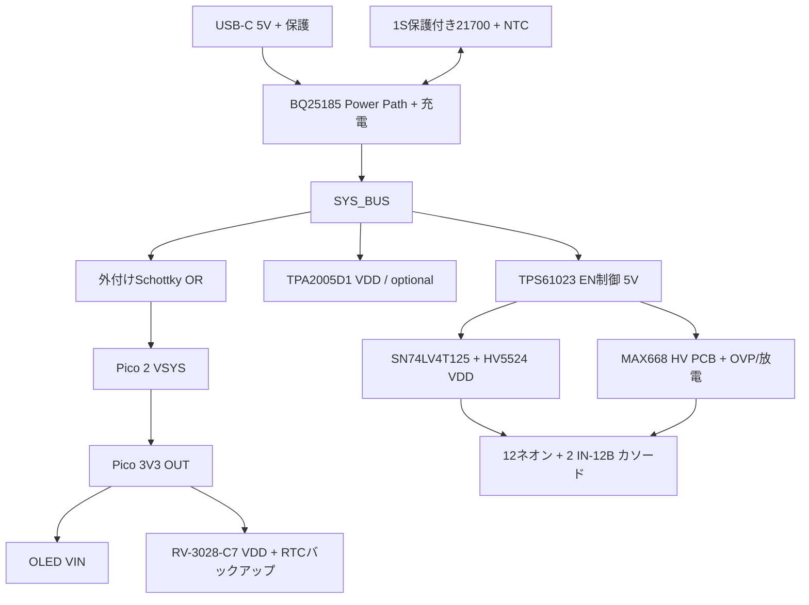

# Rev.A 統合ネット仕様・設計差分（PWR / CTRL / HV）
Updated 2026-11-14 JST
Status: **PROPOSED / NOT A KICAD SCHEMATIC / NOT ORDER-READY**
これは2026-11-14までのドラフトを**Rev.Aの単一設計候補**へ統合するチェックリスト。全型番のピン番号や性能を再実測・再承認した確定回路ではない。旧資料のTPS63031/3V3_PERIPH/XIAO/74AHCT125表記は比較履歴であり、このページの第一候補と混同しない。

## A. Rev.A第一候補・機能ブロック

- **PWR:** USB-C + BQ25185 + 5V TPS61023。**TPS63031はRev.A基準構成ではDNP/省略候補**、保険として比較仕様を旧資料に残す（独立3V3の動作検証が不要という意味ではない）。
- **CTRL/DISP:** Pico 2、OLED/RTC（Pico自身の3V3 OUT）、HV5524とSN74LV4T125（5V）、機械UI、任意TPA2005D1（SYS給電）、RTC VBACKUP。PicoのUSB debuggingと本体USB-Cは別コネクタ。
- **HV:** 5Vを受けるMAX668・未確定トランス・独立OVP・放電経路。高電圧電極を露出させない。
- 各GNDは非絶縁電源として共通の電位基準を持つが、大電流帰路・ADC/NTCの静かなリターン、高電圧の帰路はレイアウトで管理。基板間ケーブルのGNDを「単一線で全電流OK」と決めない。
- **外付け3.3Vレールを削ってもPicoが無給電時にRTC以外のICへ信号を注入する問題は消えない**。ADC/STAT/AMPへの逆給電を含めて検証。

## B. 接続ネット一覧（KiCad階層シート間に合わせる名前）
| source → destination | network | 電気的条件と状態 |
|---|---|---|
| USB-C→BQ | USB_VBUS_PROTECTED | CC1/CC2各Rd、ESD/入力保護・受電許容電流を決めるまで未完成 |
| 保護付きセル→BQ | CELL_BAT, GND | TS/MRに10kΩ/B3435セルNTC、実セル適合確認 |
| BQ SYS→Pico | SYS_TO_MCU → ORダイオード→PICO_VSYS | Pico VBUSへ直接給電しない。USBデバッグ併用で逆流実測 |
| Pico 3V3 OUT→RTC/OLED | PICO_3V3 | Pico 3.3V regulatorの外部負荷、OFF時I2Cバス・実ボード回路を検査 |
| BQ SYS→アンプ | SYS_TO_AMP | TPA2005D1任意実装。GP19 SHUTDOWNとGP12 PWM。SYS無通電時I/O逆給電防止は未設計 |
| BQ SYS→TPS61023 | SYS_BUS | 5V出力最悪負荷時の電流・熱・起動を再確認 |
| TPS61023→HV | +5V_HV, GND_HV | 連続/過渡電流、熱、コネクタ定格・配線 |
| TPS61023→CTRL | +5V_LOGIC, GND_LOGIC | HV5524およびシフタのVCCのみ。Pico VBUSと短絡させない |
| CTRL→PWR 5V EN | PWR_5V_EN | GP16。PWR基板でLOW既定にする |
| CTRL→HV EN（PWR経由） | HV_EN_REQ | GP4。HV側LOW既定・独立OVPが遮断優先 |
| HV→CTRL FAULT（PWR経由） | HV_FAULT_N | GP5。active-low/open-drainは候補、プルアップの電源ドメインと断線状態を検証 |
| BQ→CTRL STAT | CHG_STAT1, CHG_STAT2 | GP13/GP14。Pico 3.3Vへのpull-upとBQ無通電時逆給電を確認 |
| PWR→CTRL ADC | ADC_BAT, ADC_SYS, ADC_5V | GP26/27/28。PWR v3の100kΩ/47kΩ分圧とMOS遮断。Pico停止時入力注入/分圧リーク注意 |
| CTRL→PWR ADC許可 | ADC_SENSE_EN | **GP17→J3 pin10**。PWR R24によりLOW既定。ADC読取り時だけHIGH、停止過渡と無給電逆流を実測 |
| PWR→CTRL 5V GOOD | PWR_5V_OK | GP15、**オプション**。比較器/検出回路がなければ使用しない |
| Pico→HV5524 | HV_DATA/CLK/LE/BL | GP0–3→SN74LV4T125→HV5524。POL固定HIGH、BLデフォルトLOW |
| Pico→I2C | I2C_SDA, I2C_SCL | GP20/21、RTC+OLEDをPICO_3V3共通に置く |
| HV→表示 | HV_OUT, HV_RETURN | J4高圧専用・低圧J1/J2/J3と絶対に混載しない。HV出力OFF＝安全電位ではない |

## C. 低圧コネクタ（実ピン番号ではなく信号セット）
| 接続 | 機能 | 必須候補極数 | 残る設計判断 |
|---|---|---:|---|
| J1 PWR→HV | +5V_HV, GND_HV, HV_EN_REQ, HV_FAULT_N | 4 | JST XH 4極候補。FAULTの定義・5V戻りと大電流/異常耐性 |
| J2 PWR→CTRL 電源 | SYS_TO_MCU, SYS_TO_AMP, +5V_LOGIC, GND_PWR_MAIN, GND_PWR_SIGNAL | **5**（音声アンプ未実装ならSYS_TO_AMPを共有または省略可能） | SYS_TO_AMPはSYS_BUSの分岐。電線とGNDは電流・ノイズで再検討。PICO_3V3はこのハーネスで往復させない |
| J3 PWR↔CTRL 信号 | CHG_STAT1, CHG_STAT2, ADC_BAT, ADC_SYS, ADC_5V, PWR_5V_EN, HV_EN_REQ, HV_FAULT_N, GND_SIGNAL, **ADC_SENSE_EN** | **10** | PWR v3案に合わせADC_SENSE_ENをGP17から入力。PWR_5V_OKを同じJ3に加えるなら11極か信号再配置が必要。実コネクタ型番・向き未定 |
| J4 HV→CTRL/DISP 高圧 | HV_OUT, HV_RETURN | **2系統以上** | 高圧専用ハーネス・絶縁/触れ防止/沿面空間距離と帰路を決定。一般低圧コネクタ禁止 |
- **J2とJ3でGNDを重ねているのは意図的**。ノイズと故障時リターンを検討するためで、必ず別の電気GNDネットに分断するという意味ではない。
- J2のSYS_TO_MCUとSYS_TO_AMPは**電気的にはSYS_BUS共有**。同一コネクタで別ピンを割く利点（電流/ノイズ）がない場合は統合して、実際の負荷電流と接続部定格に応じて決定。
- **旧J2の4極 SYS/GND/5V/3V3と旧J3の9極はRev.A v3第一候補に含めない**。3V3_PERIPH/PWR_3V3_EN/I2C_ISO_ENをRev.Aで配線しない。USBのCC、セルNTC、全電源とEN/FAULTは基板上の論理を別途確定する。
- **GP17=ADC_SENSE_EN**（PWR基板R24=100kΩでLOW既定）。GP18/GP22は予備、GP19はアンプがある場合のみ利用。ファームとCTRL回路図への実配線は未実装。

## D. KiCadの階層シート案とコネクタが担う信号
| KiCad sheet | 所属物 |
|---|---|
| PWR_USB | USB-C、CC1/CC2、ESD/入力保護、BQ25185 IN |
| PWR_CHARGE | BQ25185、TS/MR NTC、セル保護配線、STAT、充電設定 |
| PWR_5V | TPS61023、1µHインダクタ、EN、5V監視、出力 |
| CTRL_MCU | Pico 2、VSYS ORダイオード、電圧ADC入力 |
| CTRL_UI | ACTION/NEXT/エンコーダ/I2C OLED |
| CTRL_RTC_AUDIO | RV-3028-C7/バックアップ、TPA2005D1（任意） |
| CTRL_HVDRV | SN74LV4T125、HV5524、32ch割当/出力抵抗/接続 |
| HV_POWER | MAX668、トランス、FET、整流/FB |
| HV_SAFETY | 独立OVP、起動ゲート、放電/ブリーダ/試験点 |
- 実際の物理PCBはPWR/HV/CTRLの3枚を基準にし、表示の取り付けでさらに基板分離が必要かCADで検討。
- **この文書はネット一覧**。KiCad ERC、フットプリント確認、高圧の沿面/空間距離と測定プローブアクセス、回路部品の一次仕様照合を行う前は発注不可。

## E. 不一致・未解決の一覧（今のままならNo-Go）
1. **legacy表記：** docs/architecture.md、pwr-schematic-nets.md、board-interconnects.md、pico2-pinmap.mdの独立3V3、74AHCT125、XIAO、3極接続は旧案。Rev.A基準を本仕様に合わせるが、旧版の比較/試算は残す。
2. **USB-C入力**: CC広告/USB default current、VBUS保護IC型番・配置、BQ25185/CE・NTC・ILIMの実配線は未確定。
3. **電池保護と発熱**: 保護付き21700の型番、端子保持、セルに適合するNTCと充電温度、密閉PETG内の合否。
4. **TPS61023最悪負荷**: 最低SYS時の電流/効率、起動ピーク、銅箔・インダクタ温度。
5. **HV回路**: TTRN-060S-013-Tの枝番電気仕様/スナバ/OVP閾値/放電は未確定。最優先のHV発注ゲート。
6. **HV5524の表示制御**: BL LOW + POL HIGHで全消灯は論理5Vが正常なときの条件。**5V喪失・MCU停止でもHV200Vが残ると出力状態は保証されない**。別系統のOVP/遮断/残留電圧放電とカバーが必要。
7. **RTC**: 47µF MLCCによる保持は理想値であり、漏れ・有効容量・EEPROMトリクル設定/復電後の読み出し確認が必要。
8. **I2C/ADC/STAT/AMP**: Pico USB-only、BQ USB-only、セルのみ、同時接続での逆給電・絶対最大・起動/停止電流。
9. **物理/製造**: コネクタ実型番・Pin1と向き、圧着、HV独立接続、Pico USBと台座の干渉、WQFNリフロー、¥50,000総額。

## F. 試験の最小順番
1. PWRはHVなしで5V負荷試験、充電系はセル模擬とNTC模擬を先行。USB/BAT/SYSの電流上限を測る。
2. CTRLは**低電圧のみ**でGPIO、I2C、OLEDとRTC、アンプ、74LV4T125のレベル変換/HV5524 blankingを確認。
3. USB別口の接続、Pico only、PWR onlyの逆流・不意の起動を確認。
4. 独立HV基板を教員監督・安全治具・ダミー負荷で評価（OVP、放電、電力、熱）。
5. 電池/HV/CTRL全負荷・密閉筐体で熱、誤作動、低電池、安全停止を確認してから統合・完成品への流用を判断。

## 参考
- [CTRL電源案](ctrl-power-domains.md) / [PWRピン別接続](pwr-schematic-nets.md) / [HV制御・RTC](ctrl-driver-rtc-schematic.md)
- [PWR↔CTRL/HVインターフェース](board-interconnects.md) / [Pico GPIO](pico2-pinmap.md) / [電源シーケンス](pwr-sequencing.md)
- メーカー: https://datasheets.raspberrypi.com/pico/pico-2-datasheet.pdf ; https://www.ti.com/lit/ds/symlink/bq25185.pdf ; https://www.ti.com/lit/ds/symlink/tps61023.pdf ; https://ww1.microchip.com/downloads/aemDocuments/documents/APID/ProductDocuments/DataSheets/HV5524-32-Channel-Serial-to-Parallel-Converter-Data-Sheet-DS20006850.pdf
