# PROJECT-NIXIDORO — Research Tech Tree

Status snapshot: **2026-11-25 JST**. Canonical data: [tech-tree.yaml](tech-tree.yaml).
Evidence: [WORK-INT-008](verification/2026-11-25-2159-JST-WORK-INT-008-neon-revision-and-lifecycle-gate.md), [WORK-INT-007](verification/2026-11-25-0956-JST-WORK-INT-007-cutoff-energy-and-current-gates.md), [decisions](verification/decisions.md), [open issues](verification/open-issues.md).

Views below partition the canonical dependency edges. Repeated IDs denote the same node; all incoming prerequisites apply together, including MILE-02 parts A and B. Alternative nodes are candidates, not adopted hardware. Locked release gates do not prohibit research. No node count implies percentage complete or permission to buy/test/fabricate.

States: documented = artifact exists; in_progress = exit evidence incomplete; alternative = comparison candidate; rejected = rejected in stated scope; locked = release gate incomplete; verified = only a precisely passed scope. There are no newly verified hardware nodes.

## 1. Requirements and draft baseline

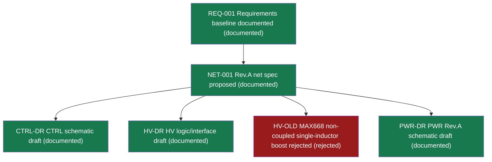

## 2. HV comparisons and voltage protection

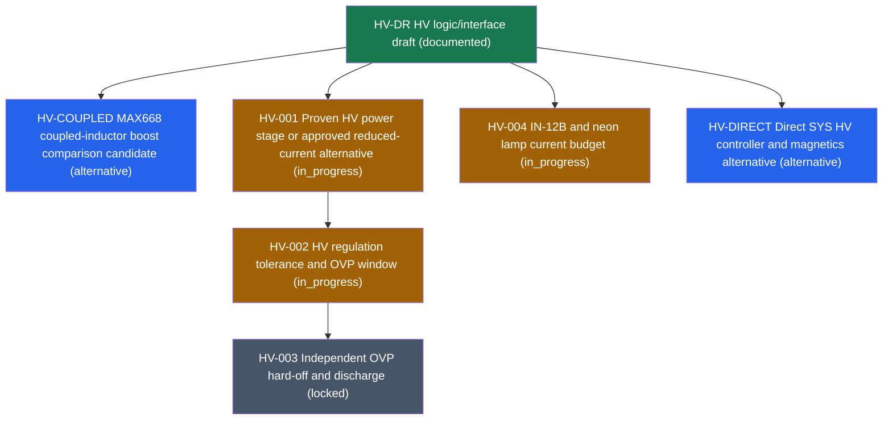

## 3. Supply and operating modes

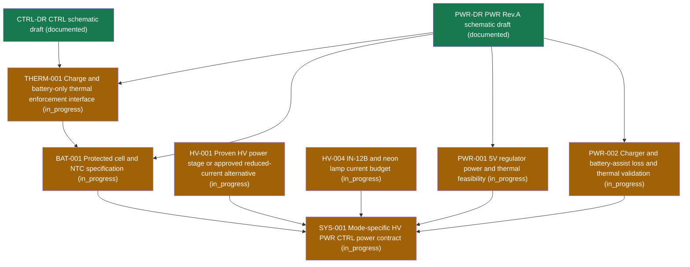

## 4. Shared capacitor energy contract

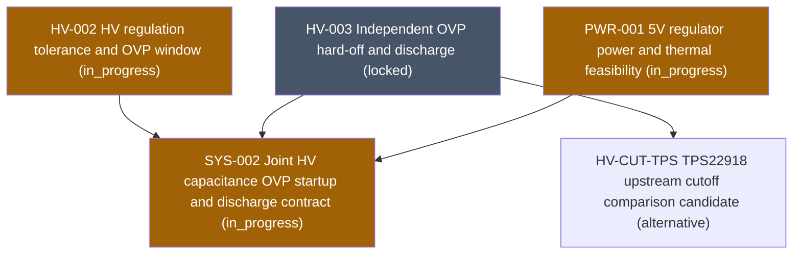

## 5. Physical interfaces and HV bench review

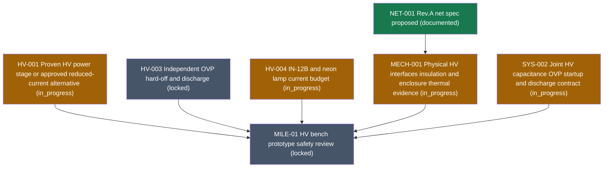

## 6. Integrated release prerequisites, part A

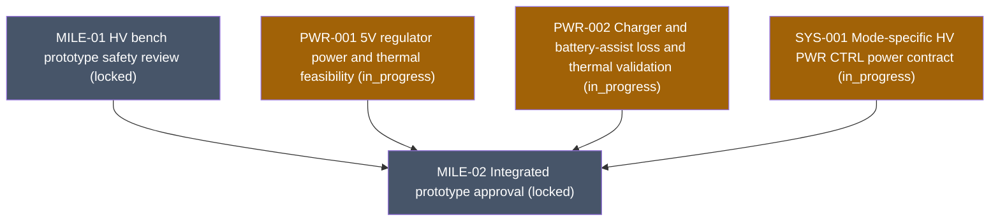

## 7. Integrated release prerequisites, part B and CTRL

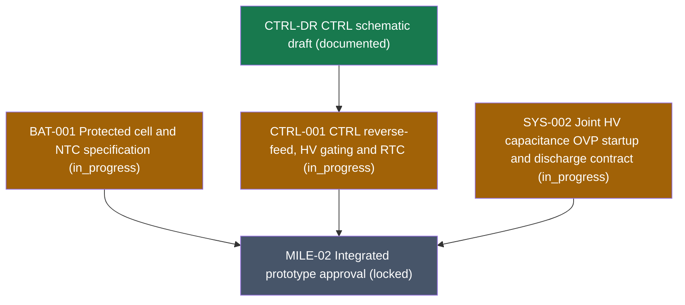

## 8. Parts, cost and manufacturing gate

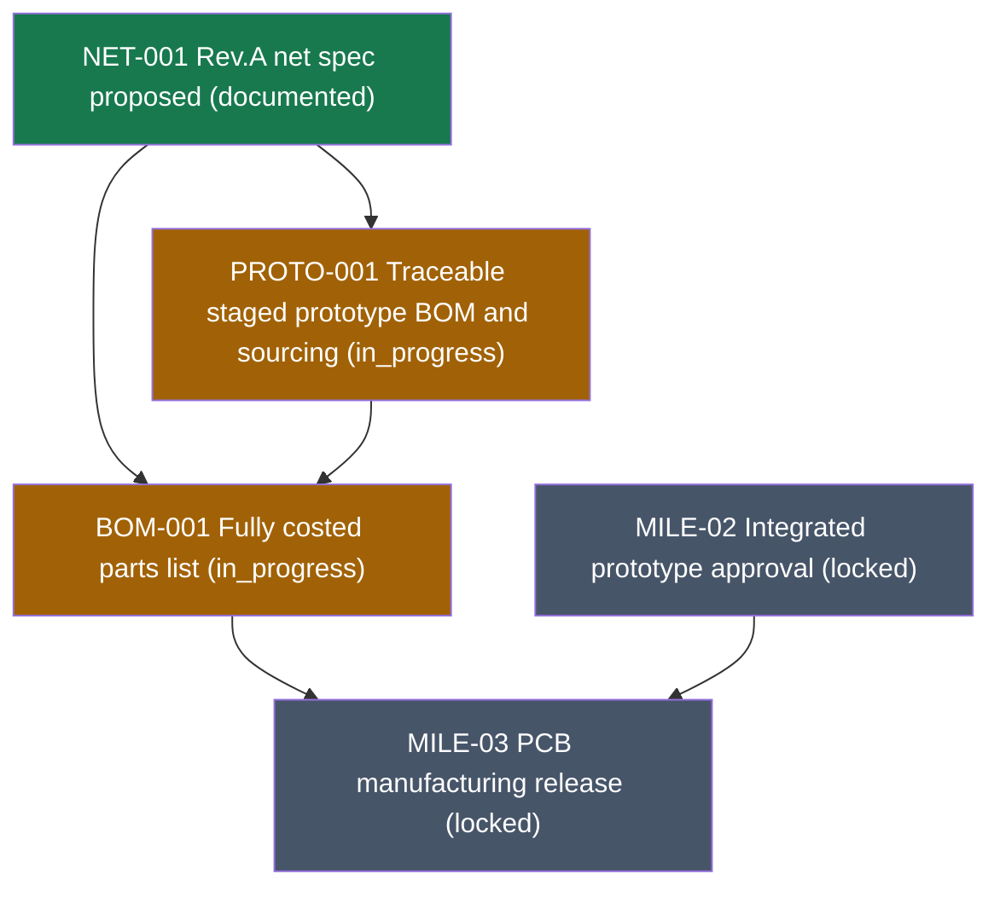

## 9. Flyback sourcing and scoped rejection

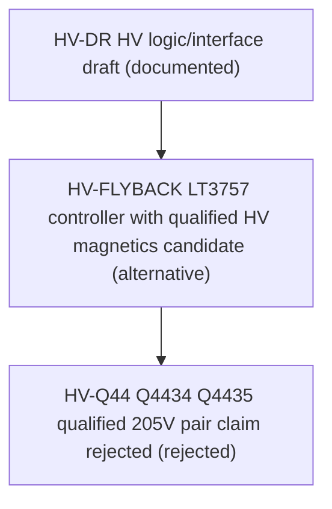

## 10. Multiplier and ordinary boost distinction

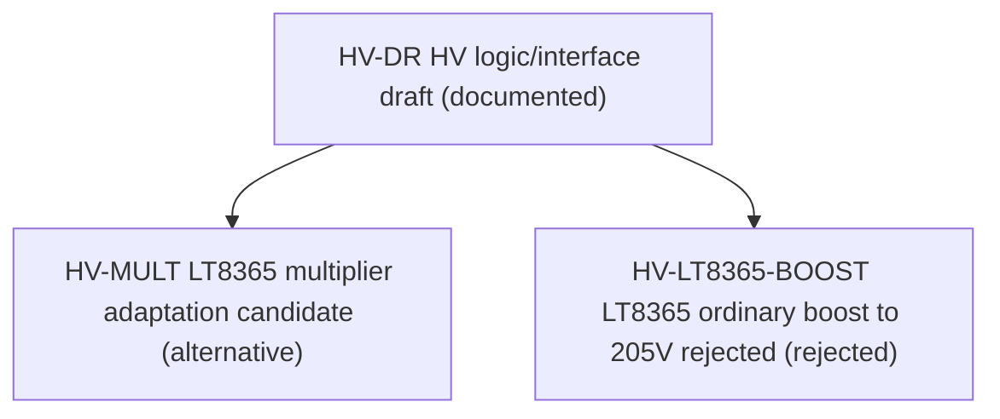

## 11. Comparator and actual magnetic candidates

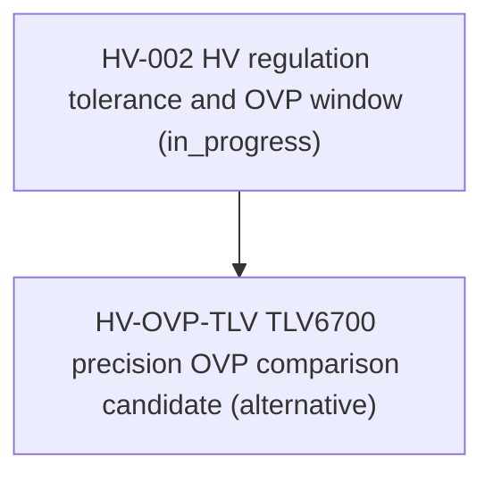

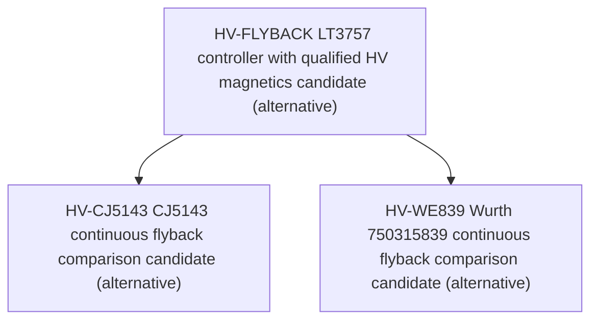

## Current integration notes

[WORK-INT-008](verification/2026-11-25-2159-JST-WORK-INT-008-neon-revision-and-lifecycle-gate.md) adds A1A revision/DC current and exact-suffix lifecycle gates (D-027/D-028).03/17 Rev2 nominal0.5mA/95VDC differs from undated manufacturer design0.6mA/90VDC; no applicable lot established. PCN333 lists A1A-T obsolete2014, not bareA1A. New B/Work evidence pending C; all node states/dependencies unchanged. Landed budget/11/25 evidence incomplete at examined HEAD; no adoption/release.

[WORK-INT-007](verification/2026-11-25-0956-JST-WORK-INT-007-cutoff-energy-and-current-gates.md) integrates C-027 and partially checks still-pending A04:01. D-024 inventories downstream LV cap energy after upstream opening, magnetic storage, timing supply and alternate feeds with same actual HV Cmin/Cmax. TPS22918 candidate is alternative,2us is typical,no maximum, LV QOD weakens atVIN loss and is notHV discharge.
C-027 confirms Work005 timing/Wurth scope and B09:03 arithmetic. D-025 keeps LT8365 lowSYS proxy distinct from actual charge-pump SW current. No real topology/parts or safety gate qualified.11/25 09:56 evidence and landed budget remain incomplete; no hardware/spec change.

[WORK-INT-005](verification/2026-11-24-1003-JST-WORK-INT-005-ovp-timing-and-magnetics-gates.md) integrates C-025/026. TI p6 Figure1 correction: INB rising→OUTB falling=tPLH29us NOM, not18us;maximum stop unknown. Precision-divider arithmetic is not OVP proof; TLV candidate stays alternative.
CJ5143 1.2A is L characterization, not continuous rating. Würth003.001 pins/dots and functional-insulation wording partially verified;typ3.2A and50–200kHz typical application do not guarantee target. New candidate nodes are alternatives, no hardware verification/gate unlock.
B11/23 21:03 arithmetic subsequently reviewed by C-025. B11/24 09:03 subsequently reviewed by C-027 within arithmetic/source scope. All whole-system, temperature/thermal, actual lamp and budget holds below still apply.

[WORK-INT-004](verification/2026-11-23-2201-JST-WORK-INT-004-power-discharge-topology-integration.md) integrates C-007〜024 and independently checks manufacturer conditions. No hardware node verified or release gate unlocked.
D-017 canonical load accounting separates lamps/bleeder/OVP-divider/driver-leakage, consistent voltage nodes, overhead and signed BAT current. 16mA lamp/bus boundary remains undecided. Single330k and dual300k discharge are separate alternatives; negative budget means INFEASIBLE. Example dual bleeder/450mA cannot support two digits alone. No real lamp current, resistor, capacitor or mode adopted.
D-018 retains passive/switched/hybrid discharge alternatives with same actual Cmin/Cmax, tail, startup, common-return and no-power fault proof. D-019 records manufacturer1:1 false-positive sourcing and LT8365 ordinary-boost exclusion while retaining multiplier/controller candidates.
THERM-001 remains independent charge and battery-only load enforcement plus separate HV residual discharge. C-007 reviewed the restricted Rs/Rp ratio theorem only. B11/23 21:03 arithmetic was subsequently reviewed by C-025; no physical mode qualified.
Current landed budget UNKNOWN; initial40k/reserve10k/total50k unproven. Real drawings/MPNs/thermal/fault/quotes take priority over repeated hypothetical tables. Historical reports and rejected branches preserved. YAML/Mermaid IDs, states and all dependency edges must be validated before and after commit.

