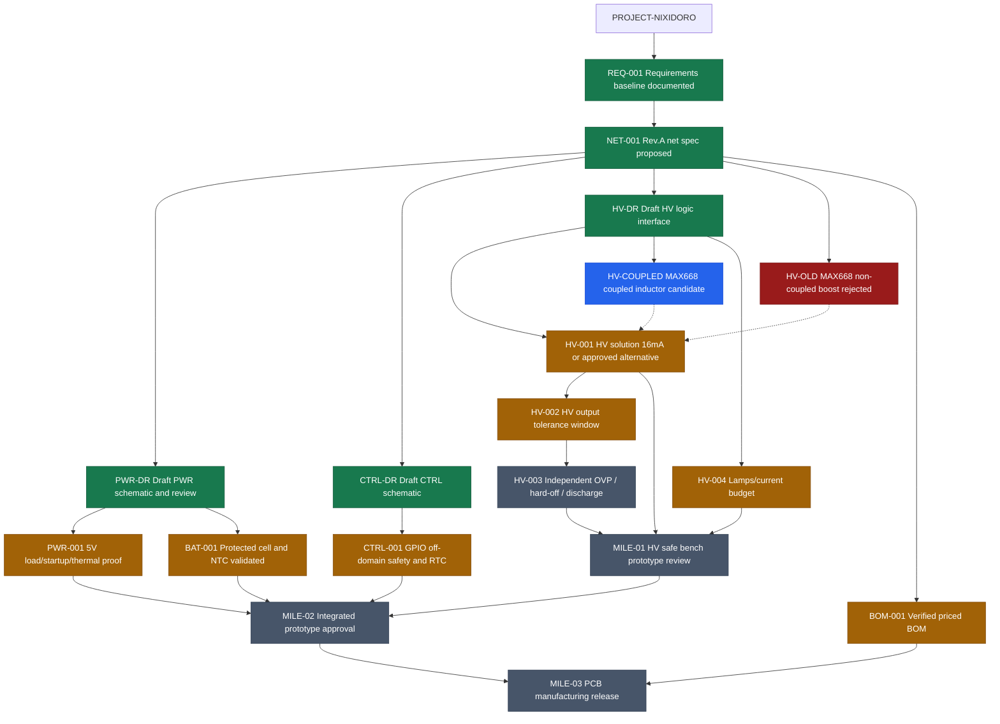

# PROJECT-NIXIDORO — Research Tech Tree (prototype)

**Status snapshot:** 2026-11-17 JST. **Design research only.** A completed documentation node does not authorize manufacture, component ordering or HV energization.

The graph below is a *curated snapshot* of the evidence in [verification decisions](verification/decisions.md), [open issues](verification/open-issues.md), and [handoff](verification/handoff.md). Node statuses must be revisited whenever new evidence is committed. The canonical machine-readable node register is [tech-tree.yaml](tech-tree.yaml).

## Current achievements and future unlocks

### Recent new research branch (2026-11-17)

**HV-COUPLED: MAX668 coupled-inductor boost** is now an **alternative under investigation**, based on documented hobbyist Nixie supply examples. This **does not** make 205V/16mA continuous or independent OVP verified. The rejected `HV-OLD` node is limited to a **non-coupled conventional boost**. Evidence: [MAX668 precedent and correction](verification/2026-11-17-0930-JST-max668-coupled-inductor-precedents.md).

### Meaning of node states

- **Documented** (green): a specific research/documentation artifact exists. It is **not** electrical validation or design approval.
- **In progress** (amber): calculations or selection are underway, exit conditions are not met.
- **Locked** (slate): prerequisites incomplete; must not claim this milestone is reached.
- **Rejected** (red): evaluated approach failed under documented conditions; preserve rationale as knowledge.
- **Alternative**: a candidate branch to compare without changing user-approved requirements.
- **Verified**: evidence-based exit criterion passed for a *precisely stated scope*. Use a separate verified status in the machine-readable data.

### Update protocol for automated reviews

1. Read `verification/handoff.md`, `verification/open-issues.md`, `verification/decisions.md`, newest dated verification report, and `tech-tree.yaml`.
2. Update only nodes for which new evidence actually exists. Include `evidence` links and an explicit `exit_criteria` field.
3. Add new discoveries as separate IDs; never reuse an old ID for a different question. Track rejected alternatives and superseded conclusions.
4. For new dependency edges, confirm they represent a true prerequisite, not merely a recommended order.
5. Keep YAML and this Mermaid view consistent. The YAML is canonical; the Mermaid diagram is a human-readable snapshot.
6. Do not infer percentage complete from node count: nodes vary enormously in risk and scope.
7. **No automatic change to KiCad, PCB manufacturing files, main branch, HV test authorization or purchase orders.**

### Important nuance

A schematic draft or successful ERC only completes a **documentation** milestone. Independent OVP, discharge, current capacity, enclosure temperature, cell safety and HV hardware verification remain separate locked or open milestones.
