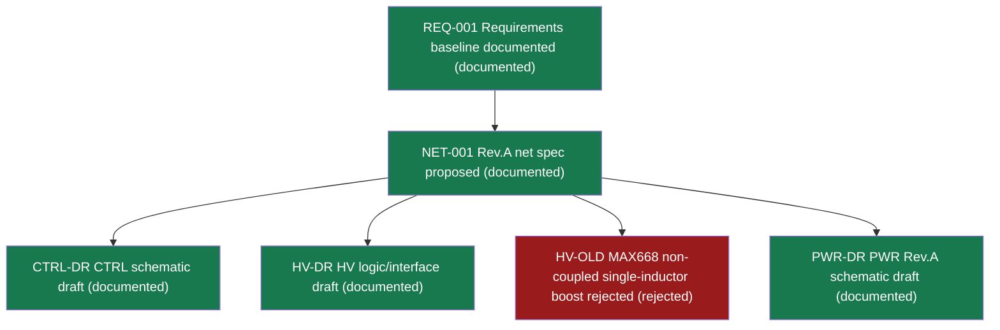
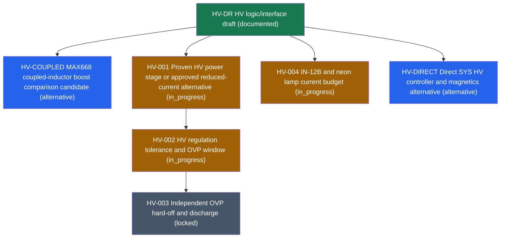
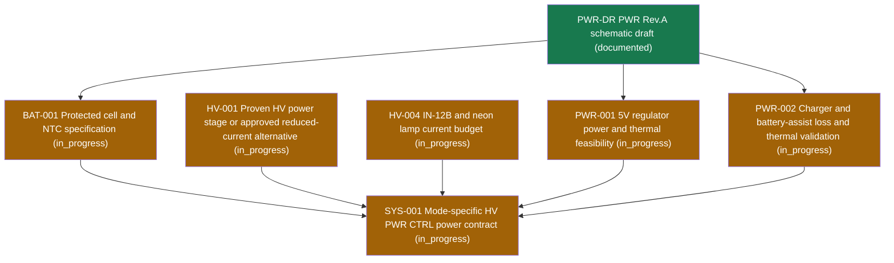
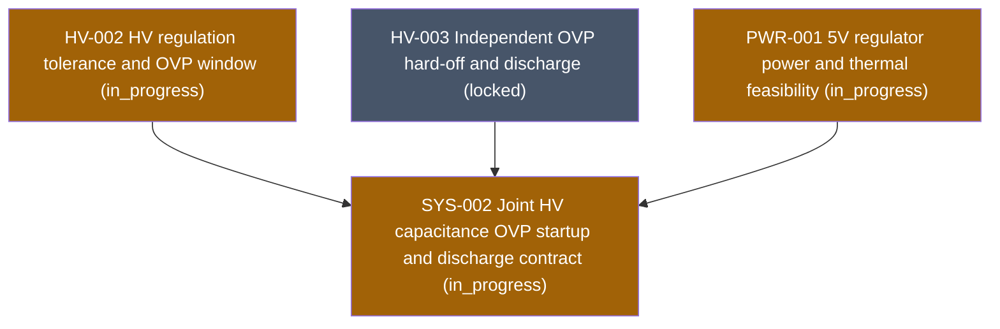
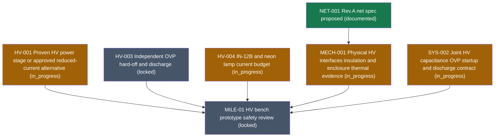
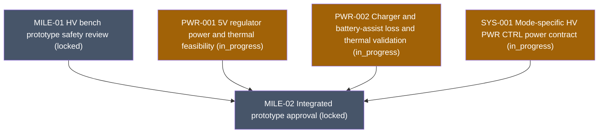
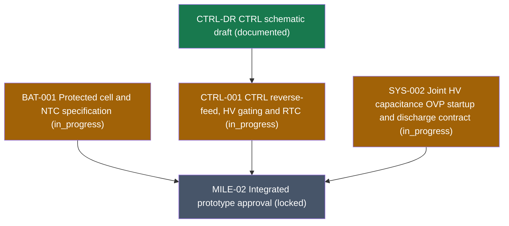
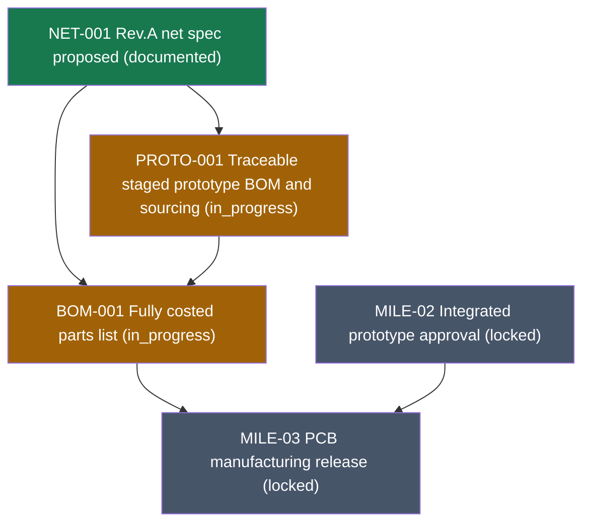

# PROJECT-NIXIDORO — Research Tech Tree

Status snapshot: **2026-11-18 JST**. Canonical data: [tech-tree.yaml](tech-tree.yaml).
Evidence: [WORK-INT-002](verification/2026-11-18-work-integration-002.md), [decisions](verification/decisions.md), [open issues](verification/open-issues.md).

Views below partition the canonical dependency edges. Repeated IDs denote the same node; all incoming prerequisites apply together, including MILE-02 parts A and B. Alternative nodes are candidates, not adopted hardware. Locked release gates do not prohibit research. No node count implies percentage complete or permission to buy/test/fabricate.

States: documented = artifact exists; in_progress = exit evidence incomplete; alternative = comparison candidate; rejected = rejected in stated scope; locked = release gate incomplete; verified = only a precisely passed scope. There are no newly verified hardware nodes.

## 1. Requirements and draft baseline

## 2. HV comparisons and voltage protection

## 3. Supply and operating modes

## 4. Shared capacitor energy contract

## 5. Physical interfaces and HV bench review

## 6. Integrated release prerequisites, part A

## 7. Integrated release prerequisites, part B and CTRL

## 8. Parts, cost and manufacturing gate

## Current integration notes

C-REVIEW-001/002 now exist; the old 11/17 no-review-package snapshot is superseded. Their accepted equations do not qualify an actual HV stage. MAX668 shutdown 70us is TYP, not guaranteed maximum.

SYS-002 connects Cmin OVP headroom with Cmax startup/discharge. HV-DIRECT remains an unreviewed alternative. MECH-001 gives physical HV/thermal evidence an explicit gate; PROTO-001 (#7) supplies traceable staged parts to BOM-001. PWR/cell work is in #8. No protection or manufacturing milestone is unlocked.

YAML nodes, statuses and dependency edges were parsed, checked for missing/duplicate IDs and cycles, and compared with the union of Mermaid views. Use exact IDs in future updates; preserve rejected alternatives and dated reports. No automatic KiCad changes, purchases, main merge, HV energization or PCB orders.
